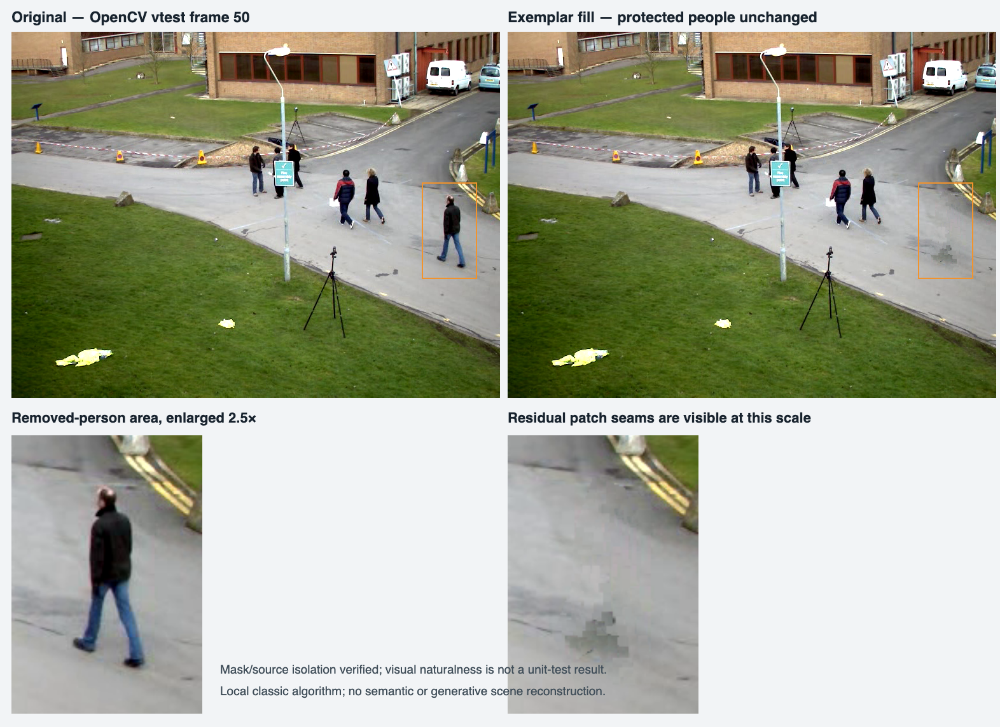

# 杂物与多余人物去除算法对账

日期：2026-10-13。实现：`core/image-core/src/inpaint.rs`。操作入口：`repair.inpaint`。

本轮把向选区内扩散邻近颜色的填充替换成确定性的经典 exemplar 补全。它能填入背景纹理；并不等于具备场景理解的生成式去人。真实街景放大对比仍有块状接缝，当前自然度没有达到专业修图验收要求。

## 原算法的问题

邻域平均可以在平滑背景中掩盖小色斑，但会把线条、棋盘和重复纹理抹掉；多次传播还可能把冻结人物的颜色当成背景来源。仅统计选区发生变化，不能证明对象被合理去除，更不能证明背景结构正确。

## 当前算法及二次封装

当前代码采用 Criminisi exemplar-based inpainting 的经典思路，由 Rust 实现，无额外模型依赖，适合 native/WASM 共用。

1. `region` 与 `mask` 的交集形成待填目标；冻结像素退出目标。
2. 只从原始图中未被选中、未被冻结且 alpha 非零的背景取 exemplar。已生成的纹理不成为下一次 donor。
3. 查找待填边界，以局部 confidence 和图像等照度线与边界法线的关系确定优先级。
4. 在目标周围 ±96 像素范围内，以已知上下文 RGB 的 SSD 匹配完整 donor patch；轻微距离代价优先附近纹理。
5. 先作预算限制的粗网格搜索，再搜索附近候选，降低遗漏周期纹理相位的概率。该步骤不是随机 PatchMatch 的完整实现。
6. 匹配窗口比复制窗口大一个像素，有助于区别重复纹理的相位。若背景太窄不能容纳该窗口，先缩匹配窗，再缩小复制 patch，最小使用 3×3；仍没有合法完整 donor 时报错。
7. 根据匹配的已知上下文作每通道恒定照明校正，限制在 ±20 字节；只复制当前仍未知的目标像素，保留已知边界。
8. 更新 confidence，直到选区全部填完；无法找到合法背景时返回明确错误，禁止偷偷混入被冻结对象。

完整 donor 检查用积分图；搜索只处理选区附近的裁切范围。没有生成模型、语义建模、Poisson 融合、全局随机搜索、透视纹理建模或视频时序重建。

论文依据：[Criminisi, Pérez, Toyama，Region Filling and Object Removal by Exemplar-Based Image Inpainting，IEEE TIP 2004](https://doi.org/10.1109/TIP.2004.833105)。当前为有范围限制的简化实现，不能把论文名称当作完整复现证明。

## 参数与保护合同

| 参数/情况 | 当前行为 |
| --- | --- |
| `mask` | 使用公共 mask 表示；coverage >0.05 的像素作为二值 hole，不把 feather 当作重建 alpha |
| `region` | 与 mask 相交；没有 mask 时使用 region；两者皆缺省会选全图并因无 donor 报错 |
| `protectMask` | coverage >1e-6 的像素保持原图，不参与目标、不参与 donor，也不作为 SSD 匹配证据 |
| `radius` | 图像短边比例，夹到 0.005–0.18；转换后的复制 patch 半径夹到 2–8 像素，再受小图尺寸限制；窄背景会自动降低到1像素半径以寻找合法完整 donor；不是人物检测大小 |
| `iterations` | 表示粗搜索质量，夹到 1–64，候选预算约为 `512 + quality*32`；始终尝试填满目标，不只填指定轮数后留洞 |
| 透明像素 | alpha=0 的 RGB 不参与背景来源和匹配证据；生成像素复制 donor 的 alpha |
| 选区外像素 | 逐字节不变 |
| 完全冻结目标 | 返回原图 |
| 没有有效 donor | 返回错误 |
| 没有完整合法 patch | 返回错误 |
| 目标无法触达已知背景 | 返回错误 |
| 原图 | 不原地修改；中途错误不会返回半成品 |

这一步没有自动人物识别：用户仍需正确圈出人物及需要一起移除的投影，或由后续模型提供 mask。错误或过紧的 mask 会残留轮廓、阴影，算法不会越过选区偷偷修补。

## 有意义的单元测试

| 测试 | 验证的真实性质 |
| --- | --- |
| `exemplar_fill_reconstructs_a_small_textured_hole_deterministically` | 48×32 彩色周期棋盘中损坏的 8×8 区域必须恢复原始 RGB，误差严格为 0；重复执行必须相同 |
| `vertical_and_horizontal_stripes_keep_their_original_frequency_and_phase` | 横向、纵向条纹中损坏的 12×12 区域必须恢复原来的相位、频率、幅度与背景 alpha，整图误差严格为 0 |
| `protected_and_transparent_rgb_cannot_influence_the_filled_background` | 只更换冻结与透明区域的 RGB，其他条件相同，填充结果必须完全相同；防止匹配证据被污染 |
| `protected_person_and_transparent_texels_never_donate_or_change` | 保护人物 RGBA 不变；透明画布不能被当作背景 donor |
| `roi_and_polygon_limit_filling_and_a_fully_frozen_target_is_identity` | ROI 与 polygon 交集以外不变；全冻结目标为 identity |
| `no_unprotected_donor_is_an_explicit_error` | 选区以外全部冻结时必须报错，不能从冻结人物取样或静默生成灰色 |
| `matching_window_shrinks_to_fit_narrow_legal_background` | 20×20 小图中自动缩小匹配窗口；未保护红色对象必须精确恢复绿色背景，冻结红色人物与原始 alpha 不变 |
| `real_street_small_person_removal_quality_and_timing` | 外部真实街景检查：选区外/保护人物逐字节不变，并输出结果供人工检查；默认 ignored，不把变化像素数当自然度判定 |

7 项自动单测通过，1 项真实街景检查显式运行通过。自动测试验证的是算法合同和可控纹理恢复，并不证明真实照片自然度。

## 真实街景与耗时

来源：OpenCV 开源仓库 [`samples/data/vtest.avi`](https://github.com/opencv/opencv/blob/4.x/samples/data/vtest.avi)，用 ffmpeg 取第 50 帧，768×576。

目标：画面最右侧的完整行人，使用 polygon 圈选；冻结中间 x=495–600、y=204–319 的两个人。参数为 `radius=0.008`、`iterations=32`。

最终版本机实测，算法计时不含读取/保存 PNG、编译或加载模型：

| 运行方式 | 算法耗时 | 改变像素 | 保护人物与选区外 |
| --- | ---: | ---: | --- |
| native debug | 11306 ms | 5268 | 逐字节不变 |
| native release | 1500 ms | 5268 | 逐字节不变 |

接入最终工程并加入选区外断言后复测为 1907 ms，输出逐字节一致；这两次运行期间存在并行构建/测试，耗时是样片实测，不能当作跨设备性能承诺。

debug 与 release 导出的 PNG SHA256 相同：`83e241eec83b2d1e16f4290cb241282b4949c64c0e704896b2104a6bbb5903a6`。这验证当前两种 native 构建一致；WASM 性能与 native/WASM 逐字节一致性由工程统一验收另测。



人工观察：人物已被去除，保留人物和其余画面不变；路面大致延续。原人物下半身附近仍有灰色块、重复纹理与断续接缝，放大后明显。因此“移除人物且守住保护边界”通过，“专业自然背景重建”尚未通过，不能声称世界领先。

本目录保留 `street-inpaint-original.png`、`street-inpaint-result.png`、`street-inpaint-comparison.png`，避免只保留控制台的成功记录。

复现：

```bash
cd core/image-core
cargo test --lib inpaint::tests -- --nocapture
RETOUCH_STREET_QA_INPUT=../../doc/qa/street-inpaint-original.png \
RETOUCH_STREET_QA_OUTPUT=/tmp/street-inpaint-result.png \
cargo test --release --lib \
  inpaint::tests::real_street_small_person_removal_quality_and_timing \
  -- --ignored --nocapture
```

## 尚未满足的质量要求

- 局部 ±96 像素搜索可能错过远处更合适的背景；大洞、稀疏背景、接近边缘或背景被多个人遮挡时会失败或报错。
- SSD 与单一照明偏移无法理解道路透视、复杂阴影、建筑几何、文字和被遮住的真实场景；不能凭空重建不存在的语义内容。
- patch 复制在低纹理路面仍会留下块状接缝；需要进一步加入结构约束、接缝优化和更可靠的多尺度搜索，再用真实样片复验。
- 当前 CPU release 在约 5 千像素 hole 上仍需 1.5 秒；浏览器端应在 Worker 中执行，不能直接占住交互线程。大区域需要更好的搜索与填充复杂度。
- 后续可封装 LaMa/MAT/其他开源 inpainting 模型作为可选质量路径；AI 不可用时继续提供经典填充及克隆修补，但必须明确经典填充的边界。
- 人像缩小后露出的背景缺口，也不能直接把这项有限补全的成功等同于全场景自然；需要独立的轮廓/背景质量回归。
