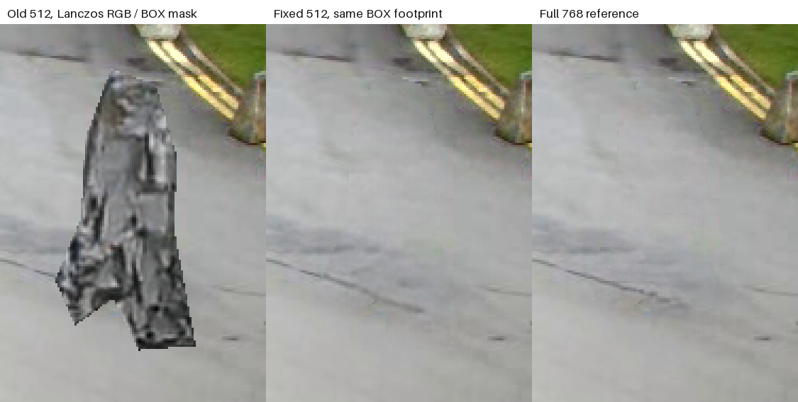
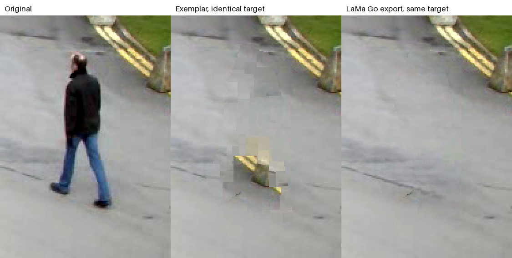
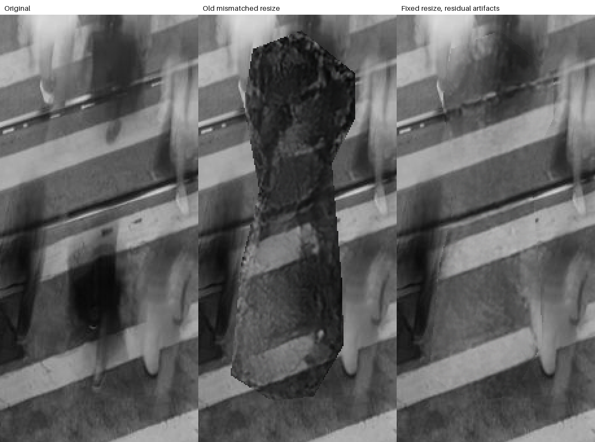
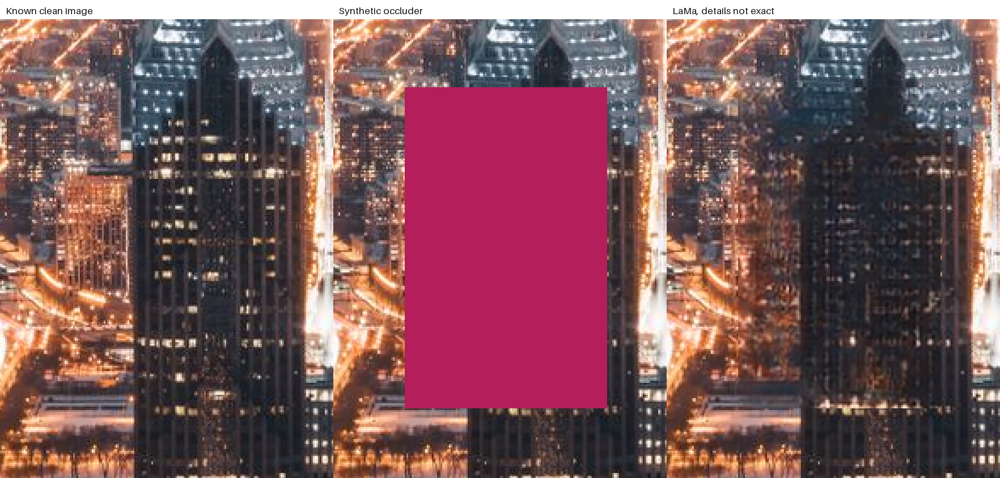

# LaMa 去人模型实测与算法对账

日期：2026-10-13。本轮验证真实 TorchScript 推理、Go 完整图导出与客户端 ONNX 转换，修复了缩放预处理造成的人形灰纹。街景小人物去除较干净；拥挤人群、建筑线条仍有明显缺陷，**没有全部达到自然度 8/10 的验收目标**。像素保护合同和模型数值一致性通过不能代替画质通过。

## 实现与执行边界

LaMa 是 WACV 2022 的公开修补模型，不是 2026 年新论文或本工程重新训练的模型。当前服务端采用原 generator 的 TorchScript 导出，由独立 Python/Torch worker 在 CPU 运行；Go 使用 Gin/Viper 管理 API、配置、导出和缓存；Rust native/WASM 负责相同 target/protection 蒙版与最终图层合成。

完整服务端图顺序是：Rust 前段操作 → 当前图像的 Rust 蒙版 → LaMa 候选 → Rust 最终合成 → Rust 后段操作。模型候选不直接冒充最终输出；透明度、blend、羽化与冻结由 Rust 合成一次，避免前后两次 opacity。`execution=client` 的启用模型图层不能由 Go 偷偷改为 server：返回 422，提示浏览器导出或显式切换。

手工圈选、冻结与模型推理不依赖 LLM、DeepAgent、云端 API key。传统 exemplar/克隆修补仍可独立使用；LaMa 缺模型或推理失败返回明确错误，不静默改用画质更低的算法。运行 worker 不自动下载模型，首次安装显式联网下载。

## 原权重验证与客户端转换核查

| 核查 | 实际证据与范围 |
|---|---|
| 官方 generator 与 TorchScript 导出 | 989 个参数及 buffer 逐个 `torch.equal` 全部相等，missing/extra/different 均空；未重新训练，也不代表论文测试集分数重现 |
| 官方来源 | `advimman/lama` revision `786f5936b27fb3dacd2b1ad799e4de968ea697e7`；官方 README 链接的 `smartywu/big-lama` zip |
| 运行权重 | `big-lama.pt`，205669692 字节；SHA256 `344c77bbcb158f17dd143070d1e789f38a66c04202311ae3a258ef66667a9ea9` |
| 官方核查 zip | 381428720 字节；SHA256 `f1b358ca24093b93a106183b98a3dea6e8ed09f3b43ea7251eb2c81e7b4575f6` |
| ONNX 来源 | `Carve/LaMa-ONNX`，revision `c3c0c9e468934d62e79c329e35d82dd09ff8c444`；208044816 字节；SHA256 `1faef5301d78db7dda502fe59966957ec4b79dd64e16f03ed96913c7a4eb68d6` |
| ONNX 接口 | opset17；RGB float NCHW `[batch,3,512,512]` 输入 0..1，mask 1 表示填补，输出 float RGB **0..255**，不能再次乘255 |
| 原模型直接导出 | 本机 Torch2.2.2/opset17 真实导出在 `aten::fft_rfftn` 失败；不意味着其他导出工具或未来版本永远不可用 |
| Carve 表达 | 没有 DFT 节点，以 216 MatMul、216 Einsum 等表达 Fourier 计算；已安装 ORT-Web1.30.0 支持 WebGPU DFT/Einsum/MatMul，不应笼统说浏览器没有 FFT 支持 |

证据：[weight-verification.json](background-lama/weight-verification.json)、[client-onnx-inspection.json](background-lama/client-onnx-inspection.json)、[direct-onnx-export.json](background-lama/direct-onnx-export.json)。

同一街景输入缩到512×384并对称 pad 到512×512，TorchScript 与 Python ORT CPU 使用完全一致的图像/蒙版 tensor：

| 项目 | 结果 |
|---|---:|
| Torch CPU，4 threads | 6914.79 ms |
| Python ORT1.20.1 CPU，4 threads | 5726.48 ms |
| 最大输出误差，0..255单位 | 0.003311 |
| 全图平均输出误差 | 0.000004095 |
| 洞内平均输出误差 | 0.000125387 |

224 个大 initializer 中147个与原权重逐字节相同，其余未逐项归因。该样片数值核对支持转换的可信度，不表示所有设备/图像严格一致，不是浏览器性能数据。Raw ONNX candidate 包含模型推理洞，必须恢复原 target 外、保护和 alpha 后才是最终结果；`street-client-onnx-square512.png` 是 raw，`street-client-onnx-final.png` 是本次最终合成参考。真实浏览器执行另外记录在 [FUNC-016](../func/FUNC-016-local-model-inpaint.md)，不得用 Python ORT 成功代替浏览器验证。

## 发现的真实预处理错误

旧路径先将目标、冻结及透明 RGB 置零，再用 Lanczos 缩小图像，用 BOX 缩小 mask。Lanczos 的更宽、带符号取样范围将黑洞带入 BOX 判定为已知的背景；模型看到被污染的轮廓，生成整个人形的灰石纹。目标外逐字节不变的测试无法发现这种目标内部错误。

修复采用图像和 mask **一致的正面积 BOX footprint**：任意模型像素只要覆盖未知原像素就属于推理洞。推理洞可膨胀，最终输出仍只写原目标。增加均匀背景缩放回归：所有标为模型已知的像素不得出现黑 halo。客户端采用相同的面积覆盖原则，等比例缩放并补到固定正方形，不拉伸照片。

下图左为旧512错误，中为修复512，右为未缩小的768参考；同一 Pillow 蒙版和冻结区域。512修复真实推理消除了原有灰纹，仍有低分辨率带来的模糊。

随后复查强缩小场景：8192×1024缩到256×32，单像素覆盖只有1/1024，uint8 BOX会将它量化成0。已改为float BOX后coverage >0：一个目标像素、一个保护像素、一个透明像素的三个推理洞全部保留；新增回归在修改前确实失败、修改后通过。若保守缩小后全部模型像素未知，直接报错并提示增大max_side或使用crop，禁止无已知背景推理。

旧输出与 benchmark 文件保留在本目录，避免覆盖失败证据。最终`area-mask-v3`写入Go缓存键，旧候选不能命中新版本缓存。下面真实QA是在v2时完成；另外逐像素核对street512/street1024/crowd1024/architecture1024/canonical-street1024的v2/v3推理蒙版差异全部为0，因此此边界修复不改变这些样片模型输入，无需重复推理冒充新增画质进展。证据：[float-mask-coverage-regression.json](background-lama/float-mask-coverage-regression.json)。

## 三张实测照片

源文件、尺寸、来源与 SHA256 见 [source-manifest.json](background-lama/source-manifest.json)。所有目标外/protection/alpha 数字均基于最终 RGBA 对比，不是“目标有改变”统计。

### 街景：同一 Rust 目标对比传统与模型

来源：OpenCV [`samples/data/vtest.avi`](https://github.com/opencv/opencv/blob/4.x/samples/data/vtest.avi) 第50帧，768×576。去除最右侧行人，保护中间两人。

Pillow 多边形 mask 选中5422像素；公共 Rust mask 按归一化像素中心光栅化选中5277像素。两者边界不同，不能混用指标。下面传统 exemplar 和 Go LaMa 导出都使用同一 Rust target/protection，图分别是 `street-exemplar-canonical.png` 与 `street-go-export.png`。

人工观察：传统 exemplar 将黄色护栏错误复制到原人物下半身，并有拼块；LaMa 基本恢复灰路面，人物消失，路面线条大致延续，局部仍略模糊。该简单场景改善明显，不能由此推断复杂去人已达标。

真实 `POST /api/v1/sessions/:id/render`：首次10807.41ms，同图重复缓存476.97ms，重复RGBA完全相同；目标外改变0、保护改变0、alpha改变0。缓存耗时包含HTTP、PNG、Rust图处理，不是单纯模型推理。详见 [go-export-report.json](background-lama/go-export-report.json) 和 [street-model-graph.json](background-lama/street-model-graph.json)。

### 拥挤人群：修复后仍未通过

来源 `test/images/street-crowd.jpg`，Pexels842339，1280×854，黑白运动模糊、多条斜轨道。目标20058像素。

修复消除了旧整个人形石纹，但轨道接续有错纹、白影，原人物位置仍可看出轮廓/边界。本图自然度未通过；正确冻结与目标外不变不能抵消这些画质缺陷。修复结果 `crowd-http-fixed.png` 的HTTP29150.2ms、模型推理19087.73ms；目标外/保护/alpha改变均0，目标内19956像素改变。这些变化数值只证明写入范围。

### 建筑：有clean参考，结构仍未通过

来源 `test/images/cityscape.jpg`，Pexels373893，1280×853。保留干净图，再人为覆盖 x=520..638、y=410..598 的色块，RGB(180,30,90)，形成22491像素目标；这不是一张真实人物样片，是有已知ground truth的结构补全实验。

修复后相对clean目标平均绝对RGB误差由旧41.178降至29.852/255；竖窗与网格变成糊块，连接不准确。数值改善成立，专业建筑重建仍未通过，也不应以MAE单独给出8分。HTTP22638.69ms、模型推理21173.03ms；目标外/保护/alpha改变均0。

两张HTTP详细数据见 [http-corpus-fixed-report.json](background-lama/http-corpus-fixed-report.json)。

## 合同、测试与性能限度

包装自动测试用 fake model，验证行为，不能评价 LaMa 画质。`make background-test` 最终11 passed；Go `GIN_MODE=release go test ./... -count=1` 全部通过，缓存版本v3后`go test ./internal/api -count=1`另外通过。

最后重建并重启 Go/Worker 后，实际 v3 完整街景图导出 11.381s，缓存复用 0.313s；选区外/保护/alpha 变化均0、缓存RGBA完全一致，启用client节点导出实际返回422。Worker health确认权重已加载。此检查验证当前运行服务与代码一致，不增加画质验收结论；见 [runtime-smoke-v3.json](background-lama/runtime-smoke-v3.json)。

| 合同 | 核查方式 |
|---|---|
| target外、保护、全部alpha保持 | 包装测试与三张真实最终RGBA比较；Go混合图导出另外验证 |
| 目标/冻结/alpha0的RGB不污染模型上下文 | 更换这些不可见RGB后候选和结果不得改变；一致面积采样回归 |
| 空/全保护目标 | identity且不加载模型 |
| 非法蒙版/尺寸/参数、缺权重 | 明确422/503，不返回伪成功图 |
| optional Poisson | 保护/目标范围、合法导入与求解；仅调整梯度和接缝，不重建结构 |
| Go混合graph | 前后翻转顺序、opacity一次、冻结/alpha、disabled/opacity0验证、client禁止上传 |
| 候选缓存 | 参数与输入变化失效、成功有效PNG才缓存、错误不缓存、64MiB LRU；缓存键含权重和预处理版本 |

本机是Intel Mac、32GiB、12逻辑CPU。MPS可用但原模型 `torch.fft.rfft2` 实测 `_fft_r2c` 未实现，当前明确使用CPU，不将“设备可见”写成实际GPU运行。CPU session受同时构建/浏览器推理、权重加载与JIT影响很大：同一街景早期冷处理52秒，修复512版本一次冷处理105.6秒，后续warm完整Go导出10.8秒。不能把未控制负载的2/4/6线程实验当作最佳线程结论，不能承诺实时。

HTTP响应 `X-Inpaint-Peak-RSS-MB` 是进程 lifetime 最大RSS；本轮最高约2426MiB，不是单次推理新增内存。独立模型worker锁定串行推理。Poisson原尺寸街景推理12.0秒、总12.3秒，solver收敛只证明求解成功，不保证自然度。原模型输出、Poisson与缩放样片均保留。

## 尚需完成的画质工作

- 复杂轨道/建筑结构使用当前LaMa仍失败，应对比更新的公开模型与结构约束路径，不能继续靠label或蒙版精确性宣称达标。
- 蒙版过紧会留下发丝、阴影、运动轮廓；扩大推理洞有帮助，但最终范围仍需用户正确选中，不应偷偷越界修改。
- 自动人物识别与前景冻结不属于LaMa本身，需独立检测/分割验证。当前本页全部采用显式目标蒙版。
- 浏览器实际后端、首次加载、缓存、取消、大图和内存由客户端独立QA验收；Python ORT parity不代替这些结果。

后续候选及运行状态见 [去人模型研究](../research/background-inpainting-models.md)；MAT、BrushNet/PowerPaint 当前未实跑，不能编造效果或速度。论文：[LaMa](https://arxiv.org/abs/2109.07161)，代码：[advimman/lama](https://github.com/advimman/lama)。可选梯度融合依据为 Pérez 等 [Poisson Image Editing，SIGGRAPH2003](https://doi.org/10.1145/882262.882269)，不是ICCV，也不是生成模型。
