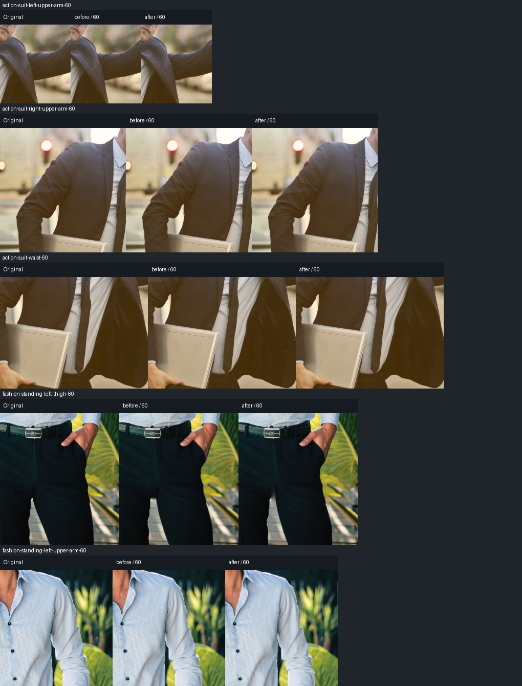
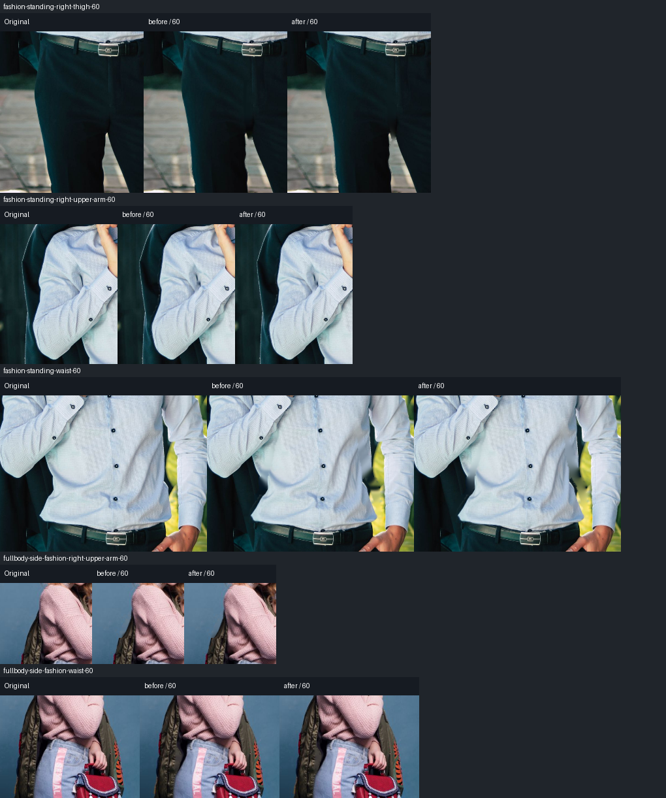
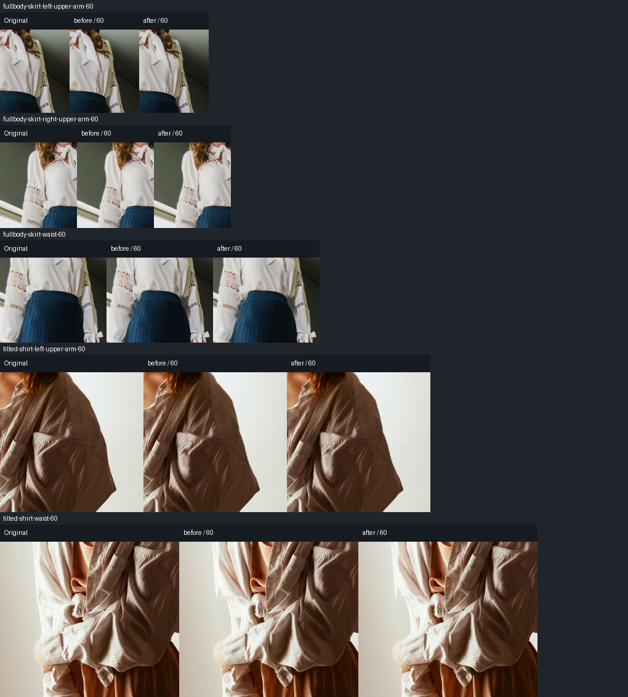

# 浮点harmonic窄带候选：未合入

2026-10-14。在v16蒙版/性能优化保持输出之后，单独测试了窄带补全。旧算法按传播顺序做整数平均，再进行8次逐步量化的扩散；一个已知线性背景、十像素宽缺口的回归测试在旧版失败，最大通道误差13。

候选用premultiplied float RGBA初始化和填充，已知背景为固定边界，排除保护供体，用red/black SOR加速harmonic收敛（omega1.65，更新量<0.025停止，最多384轮），最后一次量化。alpha与颜色来自同一合法供体边界。线性背景最大误差<=1、透明供体隐藏RGB不污染输出，候选28项body专项通过。

五图15部位 `-60/-30/+30/+60` 的60次固定二进制A/B回放已完成，冻结区/选区外/收缩时原已知背景/alpha合同保持。和v16相比共有33639个像素在本组输出中改变；不能把变化数量当效果提升。参数与输入哈希、各项裁切见 [report.json](body-harmonic-v17/report.json)。

逐项看了正60原尺寸裁切和四档回放。平滑背景局部颜色连续性有小幅变化，但总体视觉收益很弱；植物/地面结构线不会由harmonic场恢复，裤腿/袖边的细色缝、软边旧轮廓和同类衣物归属问题仍在。没有稳定的多图自然度改善，**不合入默认代码，也不提高身体功能评分**。已恢复旧strip函数，生产仅保留输出不变的v16性能改进；候选补丁和回归在 [实验目录](../../experiments/body-harmonic/README.md)。

这次结果说明量化/迭代不足确实是已知场景中的算法问题，但修复它不能自动解决真实纹理补全。后续应该把低频明暗延拓和结构/纹理恢复分开：保留真实观测边界、识别可延续的线与纹理供体，再评估窄带专用PatchMatch/模型；不能反复增加平滑轮数掩盖语义和背景错误。
