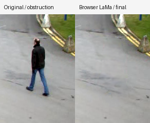
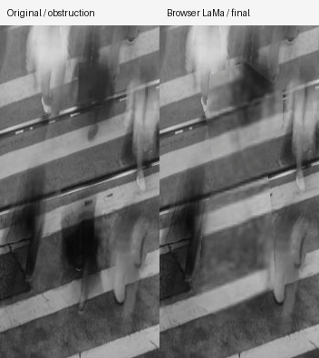
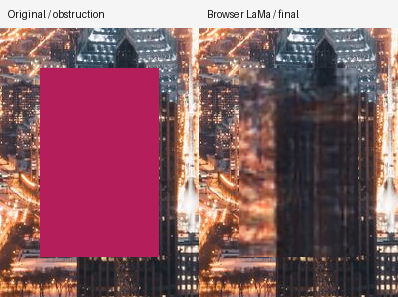

# 客户端 LaMa 浏览器实测

日期：2026-10-13。客户端去人已真实执行，普通导入和本地修图不上传图片。三张样片的选区外、冻结区和 alpha 变化均为 0；完整图层顺序与 Rust 独立回放一致。**复杂场景画质与首次运行效率仍未达到逐功能 8/10 目标。**

## 模型与执行环境

使用固定 revision 的 Carve LaMa ONNX FP32，208,044,816 字节，SHA256 `1faef5301d78db7dda502fe59966957ec4b79dd64e16f03ed96913c7a4eb68d6`。实际浏览器为本机 Chromium headless，后端是 WASM；本机没有可用 WebGPU adapter，不能将请求 WebGPU provider 写成实际 GPU 执行。模型转换与原 TorchScript 的数值核对见 [LaMa 审计](../algorithm-audit-lama.md)。

原始三图 QA 使用未发送 COOP/COEP 的临时服务器，实际只有一个 WASM 线程，耗时不能代表正式四线程部署。原日志的 `webgpu/wasm` 记录请求 provider，未测到 GPU；[browser-corpus.json](browser-corpus.json) 保留原日志并增加实际后端与隔离状态说明，不改写历史测量。正式 Vite dev/preview 已配置隔离 header；部署时也需发送相同 header。

## 真实图像与失败

三图源文件、选区和保护蒙版均来自 [background-lama](../background-lama/source-manifest.json)。下面局部图按原分辨率裁切，没有用缩小图掩盖缺陷。建筑是有 clean ground truth 的合成遮挡实验，不是真实人物移除。

| 样片 | 一线程首次处理 | 候选缓存复用 | 选区外 / 冻结 / alpha 改变 | 人工观察 |
|---|---:|---:|---|---|
| street，768×576 | 99.43s | 54.0ms | 0 / 0 / 0 | 人物消失，路面基本延续；洞内局部模糊和细纹损失，单图不能代表全部去人通过 |
| crowd，1280×854 | 50.84s | 78.7ms | 0 / 0 / 0 | 轨道接续错纹，出现明显暗块和原人形边界，未通过自然度 |
| architecture，1280×853 | 54.41s | 84.2ms | 0 / 0 / 0 | 色块移除，但窗格、楼体直线变成糊块，未通过结构重建 |

全图对照：[street](street-overview.png)、[crowd](crowd-overview.png)、[architecture](architecture-overview.png)。缓存输出与首次输出逐字节一致；三次运行均拦截 `/api/` 请求并确认请求数为 0。

## 正式四线程完整编辑图验证

在 5173 正式开发服务器实际运行同一张街景完整 graph：Rust 前段 → 浏览器模型 → Rust 公共合成 → Rust 后段。报告 [graph-report.json](graph-report.json)：

- `crossOriginIsolated=true`，实际 WASM 4 threads。
- 首次完整处理 36.187s，其中模型推理 15.155s；第一次还包含模型读取、SHA 校验、初始化及图层处理，不能称热推理。
- 修改后段并复用模型候选的完整处理 0.529s；这不是新选区的模型推理速度。
- 选区外变化 0、alpha 变化 0；40% opacity 加后段调色与独立 Rust 回放逐字节差异 0，零 opacity 差异 0。
- `/api/` 请求数 0，验证浏览器路径独立于服务端。Go 对启用、非零 opacity 的 client 节点导出返回明确错误，不会偷偷上传。

三图画质与四线程 graph 性能来自不同运行；线程数改变没有被当作新的画质改进。当前浏览器模型固定 512×512 输入，大洞或结构密集场景会损失细节；首次时延超过 Demo CPU 10s 目标。WebGPU、多浏览器和移动设备性能尚未实测验收。

## 自动化检查的范围

客户端预处理测试覆盖保留比例、RGB/蒙版共用面积 footprint、未知与保护 RGB 排除、输出 0..255 单位、crop 坐标、软保护和 alpha。坏磁盘缓存测试验证删除错误条目及下次重新 fetch，不代表恢复后的真实 208MB 模型完整推理；后者由以上实际模型运行单独证明。

12MP 测试验证候选只打包目标 RGB、小选区可处于 32MiB 预算内，调用方转移返回 buffer 后仍可从缓存字节重建。调度测试验证慢模型期间旧预览取消、最新参数交付、换图硬取消、依赖加载失败重建 Worker。包装回归不用于给 LaMa 画质打分。

运行与实现入口见 [FUNC-016](../../func/FUNC-016-local-model-inpaint.md)。尚需比较更强公开模型、结构约束和高分辨率局部策略，并在固定相同选区的真实多图对照中确认收益。

最后页面检查：导入街景、在修复工具框选目标后，“客户端去人 / 去物”和“服务端去人 / 去物”按钮均可用，导入和选择过程API上传为0。入口截图见 [ui-dual-execution.png](ui-dual-execution.png)；按钮检查不替代以上真实模型回放。
