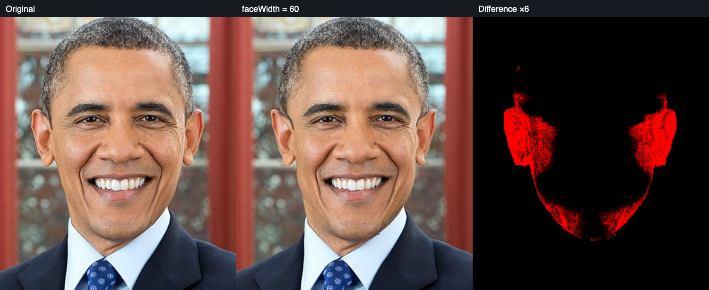
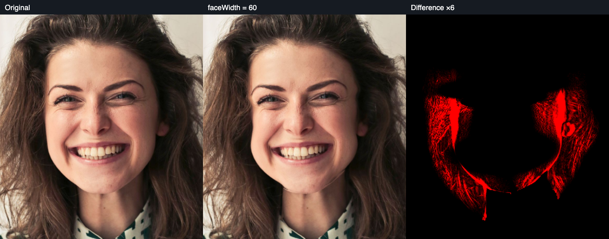
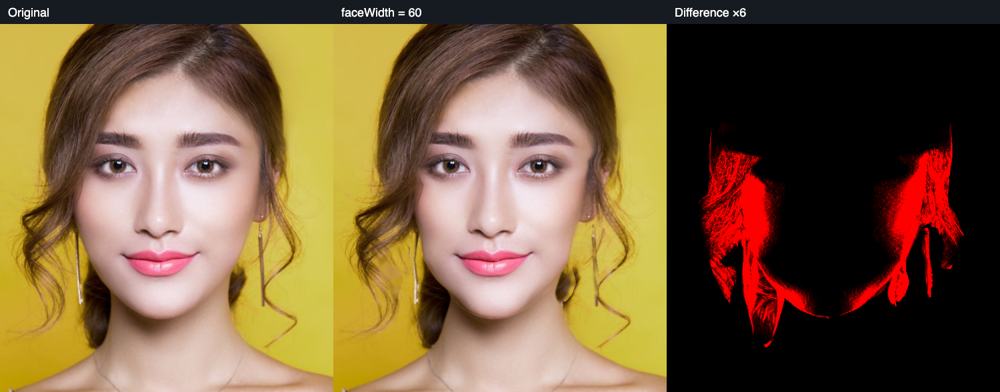
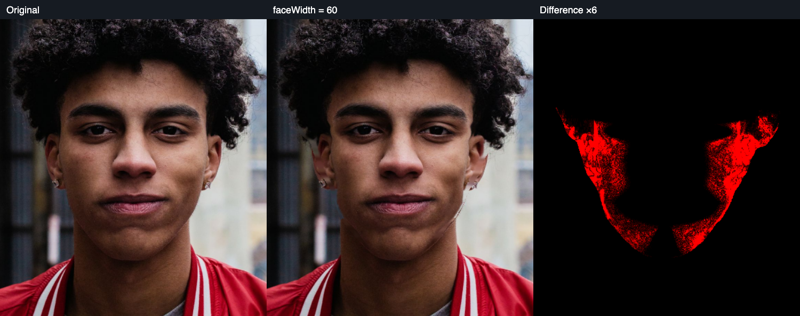
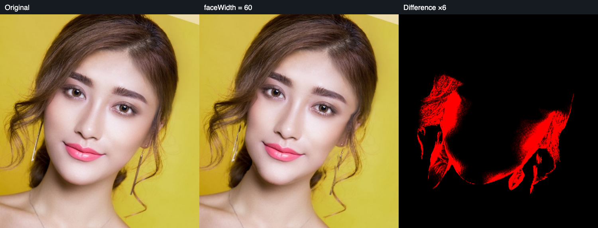
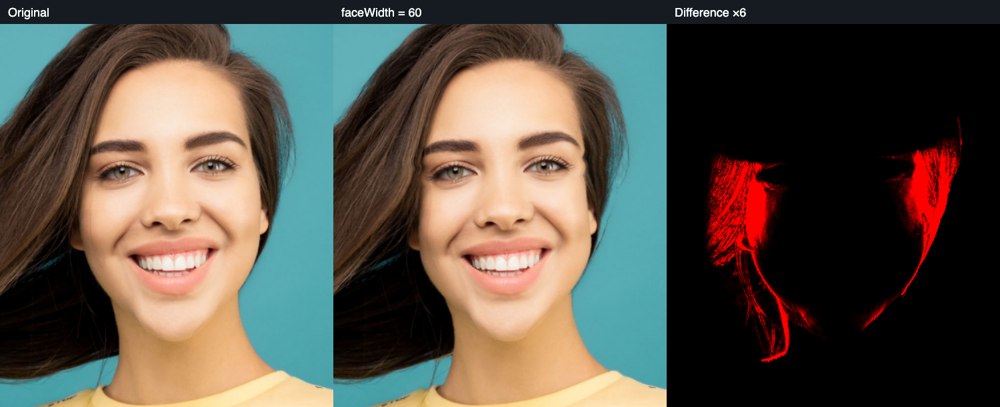

# 真实脸缘变形目视核对

日期：2026-10-13。结论：7 张照片中 6 张成功产生真实皮肤脸缘内收，1 张侧脸未检测到。当前已纠正“只改背景”和下颌误补背景的实现错误；综合精修自然度仍未通过验收，不能把可运行、像素变化和专业效果等同。

## 验证方式

输入为仓库 portrait fixture 与 [样片来源清单](../../test/images/manifest.json) 中六张不同照片。最长边限制为 1024px，浏览器运行 MediaPipe + BiSeNet 分割，将完整操作图交给 native `image-render`；六张成功图均单独设置 `faceWidth=60`，没有同时叠加磨皮或其他参数。对比图依次为原图、结果、RGB 差分×6。

逐张查看脸颊皮肤/头发交界、下颌/脖子交界、眼鼻嘴、外侧头发和背景。这里的“看见轮廓移动”仅说明修复了原算法的结构错误，不代表高强度、所有脸型和遮挡下均自然。

全量 source/output/graph 保留在本地 `test/results/native-face-contour`，大 raster 操作图不提交版本库。小型摘要见 [summary.json](native-face-contour/summary.json)。复放现有证据示例：

```bash
core/image-core/target/release/image-render \
  --input test/results/native-face-contour/portrait-makeup-source.png \
  --output /tmp/portrait-makeup-replay.png \
  --graph test/results/native-face-contour/portrait-makeup-graph.json
```

## 样片核对

| 样片 | 观察 | 当前判断 |
|---|---|---|
| fixture-portrait，短发正脸 | 两侧脸颊及下颌确实内收；中央眼鼻嘴位置目视稳定 | 基本轮廓变化成立；耳缘有局部位移和细边缘不平滑，综合自然度未验收 |
| portrait-woman，长发笑脸 | 内侧皮肤脸缘收缩，外侧长发基本稳定；原先缺 donor 的错误已修复 | 基本轮廓变化成立；脸旁发丝和耳朵跟随，综合自然度未验收 |
| portrait-makeup，妆容正脸 | 双侧皮肤脸缘内收；原黄色下颌背景线消除 | 基本轮廓变化成立；耳饰和鬓发跟随，配饰独立保护尚缺 |
| portrait-dark，深肤色正脸 | 脸颊/下颌内收；原白色背景脖子线消除，露出部位恢复为颈部颜色 | 基本轮廓变化成立；细缝和补偿纹理自然度未验收 |
| portrait-roll，同妆容样片滚转18° | 形变随面部坐标轴，皮肤脸缘内收；黄色下颌线消除 | 基本轮廓变化成立；不是独立新人物样本，仍存在近邻发丝/耳饰跟随 |
| portrait-hair，发丝交叠 | 真正脸缘内收，外侧发型大部分稳定 | 基本轮廓变化成立；靠脸发丝仍被重采样，局部下颌边界较硬 |
| profile-hoodie，侧脸 | 1024px 输入下 MediaPipe 未检测到人脸，未得到输出 | 检测失败，不能记为算法通过；手工路径尚未对该照片验收 |

## 前后对比













## 已修复的具体错误

1. 外侧头发轮廓不能代替内侧脸缘。现在 `faceContourMask/faceContour` 控制真正面部边界，`face/faceOutline` 提供完整头部 alpha 和 donor 上下文。
2. 分类置信度不是物理透明度。直接使用概率会把背景置信度尾部作为半透明人物，导致无可用背景 donor；现在先转换覆盖率，再提取匹配的 .5 轮廓。
3. 真实渐变边缘不一定在三像素内覆盖 .25/.75。旧校验误拒绝与 alpha 精确一致的 marching-squares 边界，已改为等值线位置与局部跨越校验。
4. 下颌收缩露出的可能是脖子。原实现排除所有人物 donor，再把补偿区域全部填成背景，导致深肤色白边、黄色背景样片黄边。现在 `neck` 提供真实已见颈部 donor，并与背景分层传播，避免互相污染。
5. 长发背景重建须取得完整头部周围的上下文。仅裁切内脸缘附近会丢失干净 donor；现在裁切包括真实 head outline，portrait-woman 从无法输出变为可输出。

## 自动化证据与限制

`cargo test --manifest-path core/image-core/Cargo.toml face::tests -- --nocapture`：16 项通过。包括九个轮廓参数正负方向、特征/用户保护、roll、ROI/opacity、透明图像、长发内外缘分离、软等值线和脖子/背景独立补偿。其它五官、身体、修补与 WASM 的整体检查由全工程 QA 记录。

本目视核对只验证 `faceWidth=60`，不能据此宣称所有九项参数都已通过真实照片自然度验收。局部传播不能恢复复杂隐蔽背景，分割错误和高强度带来的发丝/配饰变化仍是已知缺口。本轮保留上述失败与限制，不以降低检查范围或宣称全部通过结束验收。
