# 真实脸缘、配饰保护与强下巴核对

此文件保留前一版本的实拍和缺陷。最新局部 alpha/旧边缘冻结/neck donor 修复及已作废验证范围见 [v3 QA](face-refinement-v3-review.md)，不能把这里的历史图片和旧评分当成最新算法结果。

日期：2026-10-13。当前结论：六张重新检测的照片均能看到真实皮肤脸缘内收，`faceWidth=60` 的固定背景、头发、耳朵和配饰检查均为零变化。强下巴缩短仍有新露颈部的阴影补偿痕迹；九参数的普适自然度没有通过至少 8/10 的完成门槛。

## 当前证据与复放

当前照片最长边 768px，重新运行 MediaPipe + BiSeNet，使用已排除耳朵/眼镜/耳饰的 `faceContourMask` 和新增 `ears/accessories` masks。照片为仓库 portrait fixture 及 [样片来源](../../test/images/manifest.json) 中长发、妆容、滚转、发丝交叠和眼镜街景。滚转照片来自同一张妆容照片，不计为独立人物。

Rust 路径为真正 rigid MLS + 精确边界反采样、F/B 颜色分离、独立保护层和颈部/背景补偿。小型 [JSON 摘要](face-contour-mls/summary.json) 与下面对比图属于本轮版本。全量 source/output/graph 保存在本地忽略提交的 `test/results/face-core-review`；新增 masks 的检测缓存为 `test/results/face-core-fresh`。旧 `native-face-contour` 证据是前一轮 1024px 最近线段场，不是当前 MLS 版本。

```bash
core/image-core/target/release/image-render \
  --input test/results/face-core-review/portrait-makeup-source.png \
  --output /tmp/portrait-makeup-replay.png \
  --graph test/results/face-core-review/portrait-makeup-faceWidth-60.json
```

## 瘦脸逐图观察

图的顺序为原图、结果、RGB 差分×6。检查全部原外部像素、发丝/耳朵/配饰的稳定性，再实际查看皮肤/头发及下颌/脖子交界。差分数量只能证明改变的位置，不能证明自然度。

| 样片 | 固定背景变化 | 头发/耳朵/配饰变化 | 目视观察 |
|---|---:|---:|---|
| fixture-portrait | 0 | 0 / 0 / 0 | 两侧脸颊内收，五官稳定；修复了旧版凹轮廓覆盖一个背景像素的错误。细耳缘仍依赖分割准确性。 |
| portrait-woman | 0 | 0 / 0 / 0 | 长发内侧的皮肤脸缘内收，原有外侧长发不被拉动。边带填补不能保证复杂发丝纹理自然。 |
| portrait-makeup | 0 | 0 / 0 / 0 | 两侧皮肤边缘内收，耳饰留在原位置，旧黄色下颌三角未出现。 |
| portrait-roll | 0 | 0 / 0 / 0 | 轮廓沿面部滚转轴改变，原头发和耳饰稳定；不是另一名人物。 |
| portrait-hair | 0 | 0 / 0 / 0 | 脸侧皮肤/发丝边界内收，原有头发类别的输出像素稳定；边缘仍依赖像素分类。 |
| portrait-glasses-street | 0 | 0 / 0 / 0 | 真实脸缘内收，眼镜/耳朵不参与控制曲线，也不被整体拉动。 |

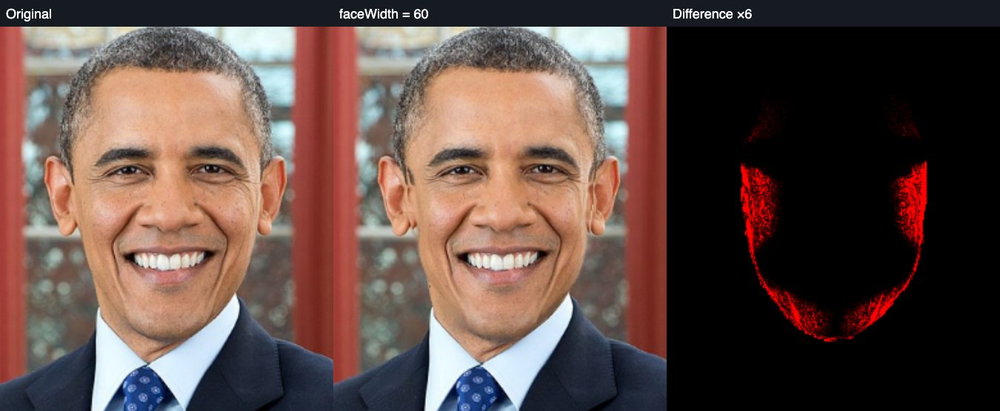

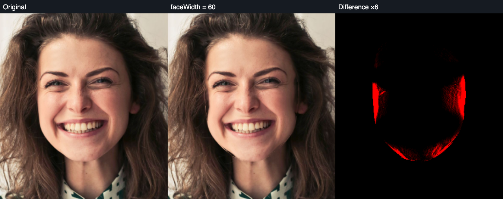

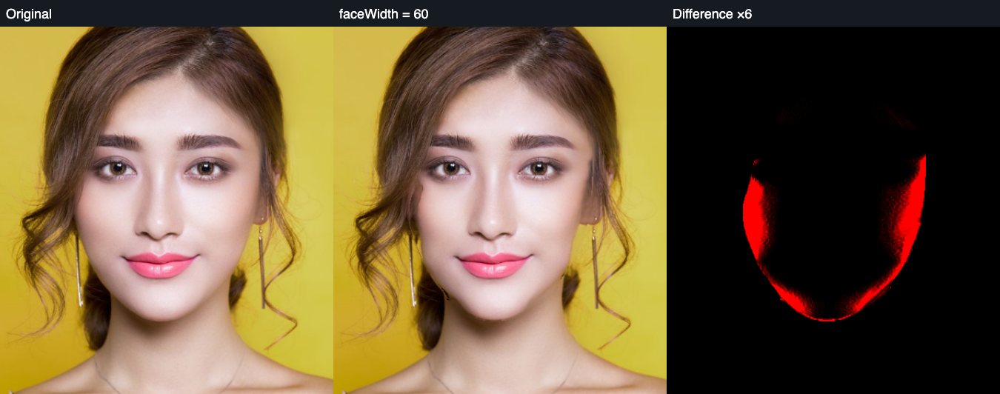

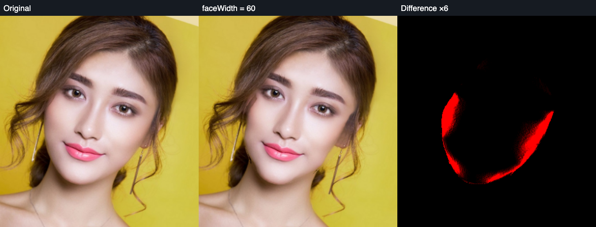

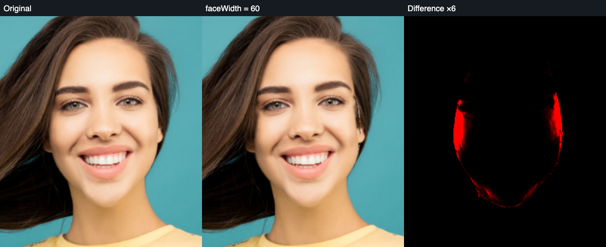

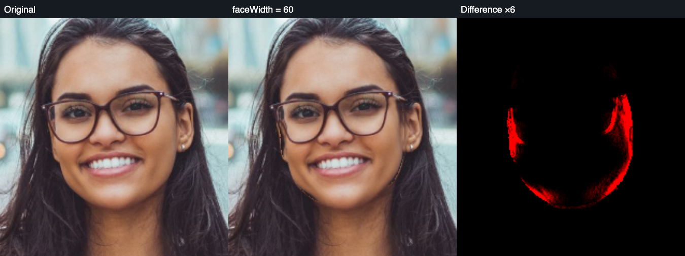

## 强下巴的真实缺陷

`chin=+100` 的下巴真正向下延长，覆盖原可见颈部。这个输出前景覆盖区域不能计为“固定背景被拉伸”；摘要中的 `bg` 按旧 head alpha 统计，包含颈部，因此此项 `bg>0` 不直接构成背景拉动证据。原 hair/ears/accessories 均保持原像素。

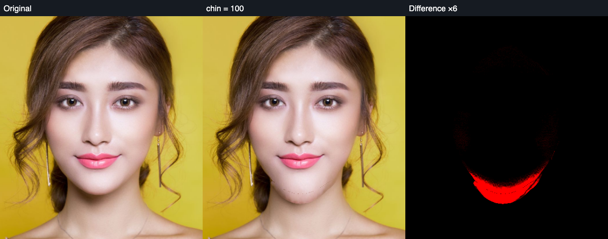

`chin=-100` 的下巴真正上移。原 alpha fringe 参与擦除后，旧下巴弧线残影减少；浮点 harmonic 外推减少最近 donor 产生的垂直条块。但新露出的颈部偏平，和原有阴影仍不吻合。这是可见的效果缺陷，**未通过 8/10 门槛**，不能以几何方向正确、保护为零变化替代验收。

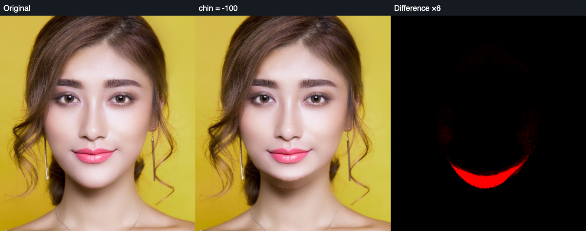

## 九参数正负真图矩阵

同一张重新检测的妆容照片单独运行九参数的 `-60/+60`，共 18 次 native 输出；没有叠加磨皮或滤镜。全部 18 项 hair/ears/accessories 保护变化为 0，ROI 外变化为 0。外扩/下巴延长覆盖原颈部或背景的区域不能直接计作背景拉伸。小型 [矩阵摘要](face-contour-mls/nine-controls-summary.json) 保存逐项数值；完整操作图留在本地 `test/results/face-core-nine-controls`。

每行分别为原图、-60、+60，直接看变化是否发生在真正目标部位。

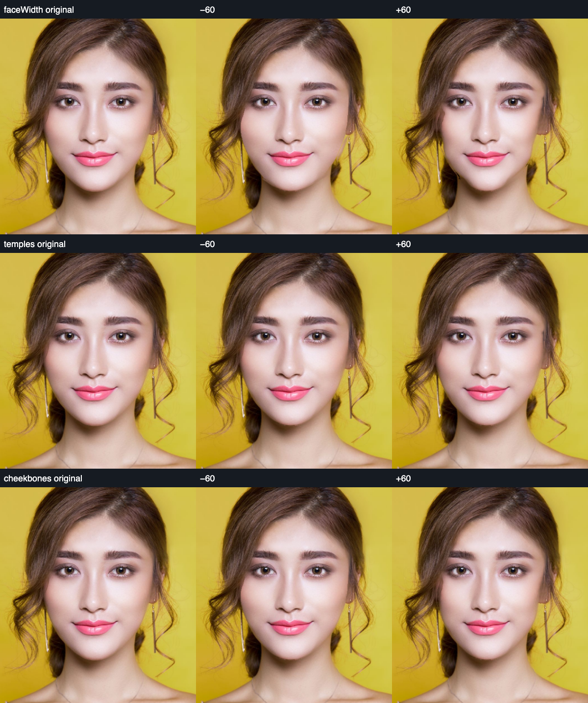

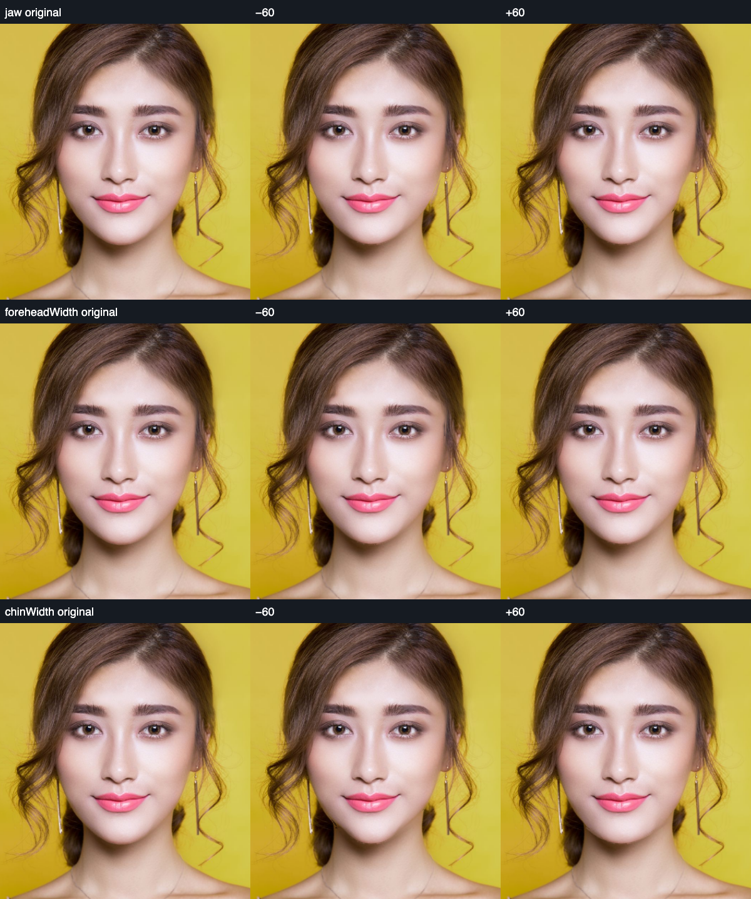

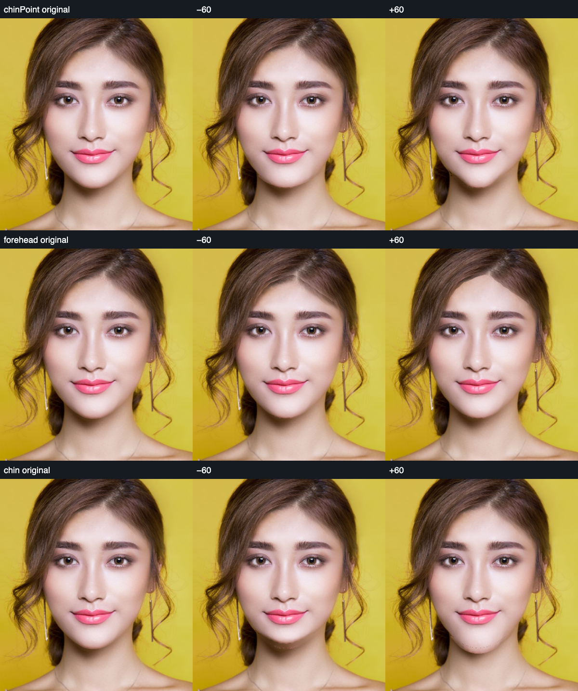

| 参数 | 本次实际观察 | 尚缺的验收证据/缺陷 |
|---|---|---|
| `faceWidth` | 正值内收明显；负值变宽 | 负值右侧新脸缘出现黄/肤色混合细线，外扩到头发区域受冻结限制。 |
| `temples` | 附近有局部变化，幅度较小 | 太阳穴与头发交界的真实轮廓移动证据不足，不能仅按 4–5 千变化像素计通过。 |
| `cheekbones` | 颧侧皮肤边缘有变化 | 外扩到头发的遮盖规则、不同骨相和细边缘自然度未验收。 |
| `jaw` | 下颌宽窄变化可见 | 负值边缘仍有色线，原头发冻结可能限制外扩；多人物颈部补偿未验收。 |
| `foreheadWidth` | 额侧皮肤区域有变化 | 头发冻结使宽侧新轮廓受限，当前无法证明真实发际线重塑。 |
| `chinWidth` | 下巴两侧宽度有变化 | 下巴/颈部交界的细纹与光照仍需复核，不据单张图给 8 分。 |
| `chinPoint` | 下巴宽窄/尖度有变化 | 单张正脸不足以验收所有形状，轮廓颜色与阴影仍依赖不准确 alpha。 |
| `forehead` | 缩短端在额头产生局部变化 | 加长端发际线基本未真正向头发内移动；头发保护和前景遮盖规则冲突，未通过。 |
| `chin` | 端点真正上移/下移 | 缩短颈部阴影不匹配，延长新边缘可见黑点；未通过。 |

这份矩阵揭示了分割概率不是物理 alpha 的实际影响：F/B 颜色估计公式通过合成软边测试，真实分类覆盖率输入仍会产生颜色线或暗点。后续需要真正的 alpha refinement 和前景遮盖头发的规则，不是更换论文名字或降低检查阈值。

## 验收范围和未通过项

| 项目 | 当前证据 | 至少 8/10 状态 |
|---|---|---|
| `faceWidth` 正值内收 | 六张 fresh 照片真实脸缘内收、全部保护指标；需扩大人物/强度样本复核细边缘 | 尚未独立评分验收 |
| `chin` 缩短 | 真实照片强参数可见颈部光照不匹配 | 未通过 |
| `chin` 延长 | 真实向下改变、无旧黄色三角；±60 矩阵可见新边缘暗点 | 未通过 |
| `temples/cheekbones/jaw/chinWidth/chinPoint` | 正负几何、锚点、保护回归与完整九参数真图 ±60 矩阵 | 有已知缺陷，真实多人物自然度未验收 |
| `forehead/foreheadWidth` 及向头发侧外扩 | 原头发输出一律冻结，可能限制目标前景覆盖原头发；现阶段不能保证发际线真实移动 | 未通过/待修复 |
| 侧脸 | 前一轮 profile-hoodie 在 1024px 下未检测到；本轮未再次检测 | 检测失败记录保留，不能计通过 |
| `faceHeight/midface/doubleChin` | 非零值明确拒绝，未实现解剖重建 | 未实现 |

没有为缺少真实照片证据的项填写 8 分。自动化性质与自然度分别核对，失败不被平均分或其他成功样片掩盖。

## 自动化与性能

当前 `face::` 20 项通过、1 项性能基准显式 ignored；另外 F/B 两项通过。`geometry::tests` 15 项通过，包含五官/对称对 hair、ears、accessories 的全部输出冻结和四个非零源采样 texel 保护，防止配饰被复制进邻近皮肤。手工 polygon 硬边与明确其他人物区域的两个回归也通过。

```
cargo test --manifest-path core/image-core/Cargo.toml face:: -- --nocapture
cargo test --manifest-path core/image-core/Cargo.toml face_matting -- --nocapture
cargo test --manifest-path core/image-core/Cargo.toml geometry::tests -- --nocapture
```

本轮六张图 native CLI 单操作约 368–692ms（包括 PNG 读取、JSON 解析、协议验证与输出）。强下巴在当前样片约 404–851ms；机器同时执行浏览器模型/编译时会变慢。makeup 768×677 的一次 native 分段观测为准备64ms、mask 裁切165ms、F/B236ms、MLS网格采样77ms、补偿34ms、层合成15ms、最终合成31ms，约620ms。运行时环境不同不能将这些数值当作稳定基准；目前没有证明达到 60fps。

`FACE_CORE_PROFILE=1` 可输出 native 各阶段时间；不会在 WASM 构建中调用系统时钟。检测模型耗时与每次数值修改耗时分开，检测可缓存；当前尚未跨滑块值缓存整套 F/B 图层。WASM 整体性能与浏览器真实交互由工程集成 QA 记录，不能套用论文 GPU FPS。

论文出处、真正移植公式、项目边界适配和未采用候选见 [研究记录](../research/face-warping-and-layered-matting.md)。
