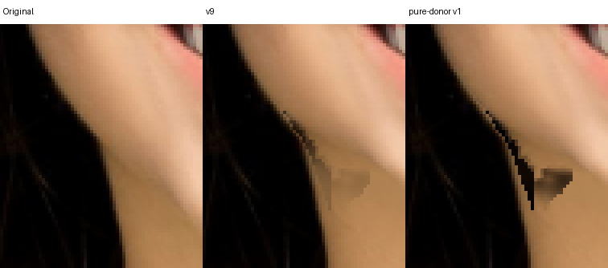
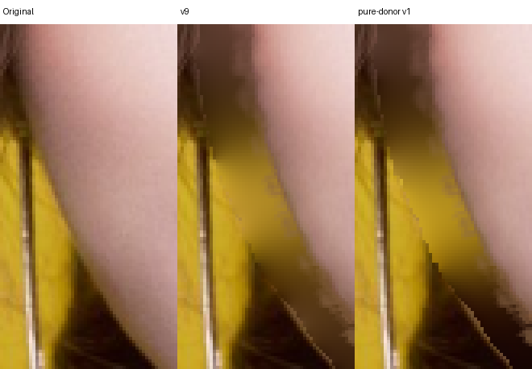

# 纯 donor v1 隔离候选：拒绝进入生产

日期：2026-10-14。候选在 v9 上把 hair/neck 可观察供体置信提高到 .95，按 2px 圆盘腐蚀同类供体；几何位移、五官保护和 hair/ear/accessory 输出冻结规则不改。低置信边带进入隐藏底层补偿。

补丁：[pure-donor-v1.patch](../../../experiments/face-donor-purity/pure-donor-v1.patch)。冻结 binary SHA-256：`8e7dedd4be2d2ef6646801b90d43c2b2c3f902a775a3e57c54081061cff96cf5`。生产源码没有应用此补丁。

8 次先行回放：makeup/woman/hair 的 faceWidth=60/100，加 hair chin=-60/-100。8/8 ROI、五官、配饰、头发和收缩场景保护通过；完整逐项报告分为 [width](width/replay-report.json) 和 [chin](chin/replay-report.json)。主评审和独立评审均看全部 8 个原尺寸对照，确认没有稳定的自然度净改善，所以没有扩大到 72 项。

- makeup：部分棕色污染减少，但更深的棕黑色齿状边出现；右耳下阶梯仍在。
- woman：基本无改善，细亮边与右下颌黑块保留。
- hair faceWidth=60/100：左脸/颈交界的深色锯齿更显眼，右侧青色区域扩大且阶梯未消失；没有恢复发丝纹理。
- hair chin=-60/-100：新增左颈黑色三角块；新露颈部平阴影未改善。

具体黑块原图坐标 (250,402)：v9 RGB=(134,98,60)，v1=(8,2,2)。隔离只读 trace 的输出逐像素等于 v1；该点两版都为 hair layer=2，BFS owner 分别为 (248,402) 与 (245,402)。因此这个具体坏点不能简单归为 neck→hair 分类迁移：更纯的黑色在不正确/混合的空间支持上也会更不自然。提高供体门槛确实还改变了其他点的分类 front，需通过固定分类的下一控制实验区分，不能据此否定所有纯度约束。

候选拒绝，保留失败补丁与固定二进制用于对照；本轮没有提高视觉评分。下一控制实验保留 v9 的 class/front/owner 完全不变，只在原有同类可观察区域中替换低置信 RGB donor，不跨 neck/hair/scene 混合。
