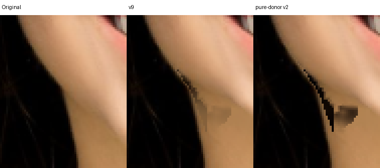
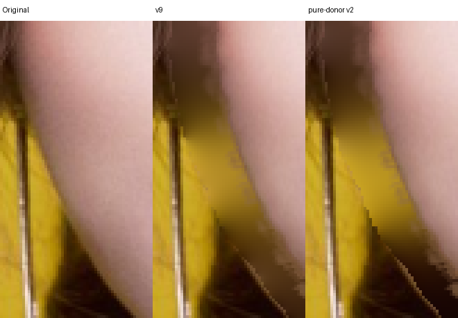

# 固定分类的纯 donor v2 控制实验：拒绝进入生产

日期：2026-10-14。本候选保留 v9 的 `known_layer`、target、protected、BFS 分类 front 与 owner 拓扑原样；只将低置信的已见 neck/hair RGB 换为同一已见类别中 .95 置信、2px 腐蚀 donor 的传播结果，分类仍以原观测区域为准。没有任何 neck/hair/scene 跨类别颜色平均。若原已见类别分量没有通往 pure donor 的路径，保留该分量原观测，不宣称其已获纯度校正。

补丁：[pure-donor-v2-fixed-classes.patch](../../../experiments/face-donor-purity/pure-donor-v2-fixed-classes.patch)。冻结 candidate SHA-256：`e50f9b92621f2feb098a6645cf23c32d23dd18505a758b353bd32db563a586a4`。该补丁仍基于 v9，与后续 v10 物理 alpha 修复分开；生产源码未应用。

与 v1 相同的 8 次先行回放，8/8 像素保护检查通过：[width report](width/replay-report.json)、[chin report](chin/replay-report.json)。主评审与独立评审均核对全部 8 张原尺寸比较，另看强值完整输出；结论一致，没有自然度净收益，不扩至 72 项。

- makeup：左下颌污染只变成更深的棕黑齿状边，右耳下阶梯保留且局部变深。
- woman：细亮线与下颌黑块仍在，变化很弱。
- hair：左脸/颈交界的锯齿、chin=-60/-100 的黑色小三角仍明显；右耳下阶梯及新颈部平阴影没有改善。

这次实验将供体颜色与分类 front 分离后，仍未解决原有几何支持与隐藏纹理问题；不能把颜色去污染当作效果加分。v1/v2 两个失败不能证明所有 pure-layer 约束无用，但证明直接提高门槛或沿原类别传播干净颜色不足以实现当前 8 分门槛。

候选拒绝，保留补丁、冻结 executable 与全部失败图。后续针对实际底层边界的候选必须基于已通过的 v10 重建，重新比较其独立收益，不把两个失败候选合入后称为改进。
