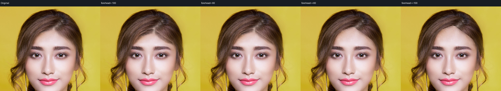
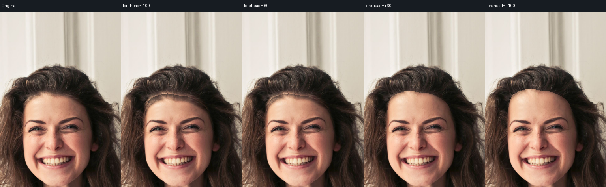
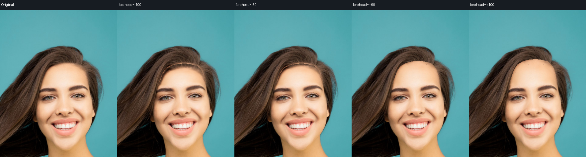
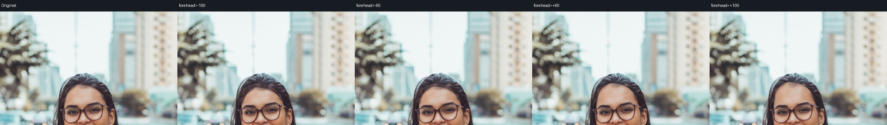

# 发际线局部覆写实验：未合入

日期：2026-10-13。生产代码已经回撤本实验，仅保留通过的 neck seam bridge。额头高度仍按 **3/10**、额头宽度仍按 **4.5/10** 记录，不能因本实验出现更多变化像素而提高正式评分。

## 方法和复放

候选把 `hair` 从绝对冻结层中分离，仅允许目标皮肤 contour 在位移宽度的小带内覆盖原 hairline。外层发型、耳饰、用户冻结保持。实验新增源码保存在 [候选补丁](hairline-override.patch) 中；它是带语义定位的源码 diff，用于说明与复现，不是生产实现。

输入是本地 `test/results/face-core-fresh` 中六张 fresh MediaPipe/BiSeNet 缓存：fixture-portrait、portrait-woman、portrait-makeup、portrait-roll、portrait-hair、portrait-glasses-street。roll 是妆容原图旋转，不计为独立人物。每张单独运行 `forehead/foreheadWidth=-100,-60,+60,+100`，共 48 次 native 输出，未叠加磨皮/滤镜。

候选 executable 留在本地 `/tmp/forehead-hairline-render`，SHA256 见 [binary-sha256.txt](binary-sha256.txt)。全量 source/graph/output 留在 `/tmp/forehead-real`；代表图和逐项小型指标随本报告保存。复放方式：

```bash
/tmp/forehead-hairline-render \
  --input test/results/face-core-fresh/portrait-makeup-source.png \
  --output /tmp/forehead-100-replay.png \
  --graph /tmp/forehead-real/portrait-makeup-forehead-100.json
```

## 观察

| 检查 | 结果与限制 |
|---|---|
| `forehead=+60/+100` | 真正向 hair 内覆盖、上移发际线；妆容样片 +100 修改 3001 个原 hairline 像素，+60 修改 1776 个 |
| 外层发型 | 48 项 `outerHairChanged=0`；该统计只证明限定带之外固定，不代表局部自然度通过 |
| `forehead=-60/-100` | 原 head-alpha 包含 hair，重建层仍按整颗 head 推断，无法正确把新露 hair 的颜色/纹理接到原 hair；局部残留肤色与发丝混合 |
| 长额头细边 | 从头发分类到皮肤层的 donor 仍是 head F/B 颜色，真实发丝穿越后仍有细接缝；局部新皮肤反采样的颜色并非可靠皮肤 alpha |
| 场景 | 五张样片 sceneChanged=0；fixture 的粗 person 统计出现 5 像素变化，需要基于原 head/target alpha 的完整 scene 合同再区分，不能直接填写为保护通过 |
| 其它参数 | 实验 override 对所有 outward contour 生效，尚未单独核对其它七参数自然度，因此不可冒险改变生产保护行为 |

## 为什么不能合入

1. `face` 是整颗 head alpha，包含 hair；`faceContourMask` 是 skin contour 分类概率。对 skin→hair 交界继续使用 head alpha，会反采样原 hair 到新皮肤，或把缩短额头露出的 hair 当作需要整个 head 背景恢复的区域。
2. 只解除 hair 冻结让轮廓“确实移动”，但没有建立独立 skin foreground/hair underlayer，也没有可靠的局部 alpha trimap。
3. 缩短需要方向一致、照明一致的真实发丝 donor/exemplar；harmonic RGB 扩散只能传播平均颜色，不能恢复发丝结构。
4. 目标 skin 遮盖内侧 hairline 是合理遮挡，现有 contract 却仍把全部原 hair 当作不可变输出。必须明确限定 hairline 编辑合同，并继续严守用户显式 protect 和外层发型合同；不能靠放宽全图保护检查合入。

下一步应先分离独立 skin alpha/hair underlayer，在窄 trimap 上做局部 RGB matting；为新露 hair 建立局部方向一致的 donor/exemplar，保持外层发型与 scene 完全固定，再用四个正负强度、多人物和遮挡样片重新验收。需要实际视觉效果证据，不能直接把分类图当作物理 alpha。








