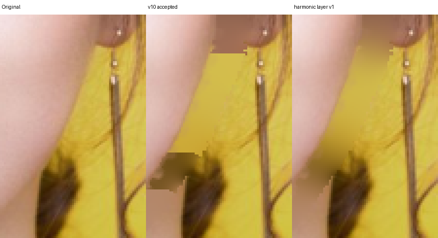
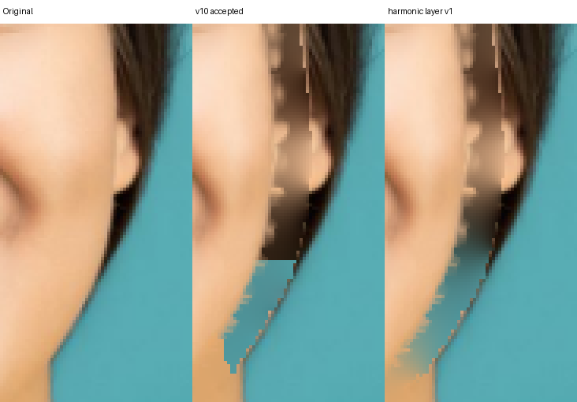
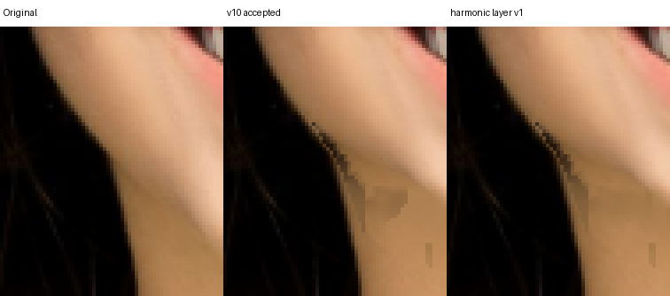
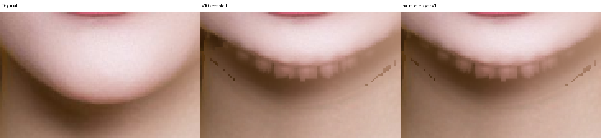

# 三层一热 harmonic 边界候选：拒绝进入生产

日期：2026-10-14。候选基于已接受的 physical-alpha v10 attempt2，SHA-256 `3b36aaaa0f3b75521cc8f7726a4a3b605619b2e95c9b69818c3cac9af9d718f8`。candidate SHA-256 `244344e67f02c10c17b9f49291f4d051a84c8cc1f8373bd1ee83ba1ca7169544`。

补丁：[harmonic-weights-v1.patch](../../../experiments/face-layer-harmonic/harmonic-weights-v1.patch)。它把 scene/neck/hair 的预乘颜色分开外推，用一热 layer 作为 Dirichlet 边界、对隐藏洞求 harmonic 权重，最后只对实际 holes 做 material mixture。输出冻结、轮廓几何与保护阈值不改；只读隔离 binary 未写入生产。

先行 8 项：makeup/hair 的 faceWidth=60/100、chin=-60/-100。8/8 hard checks 通过，完整报告：[width](width/replay-report.json)、[chin](chin/replay-report.json)。

原尺寸核对没有自然度净收益：

- makeup 右耳下硬阶梯只变为较宽的棕黄色泥，左下颌肤色被混合；原发丝与黄色背景没有被恢复。
- hair faceWidth 的耳下青色/棕色块仍在并更模糊，chin 的黑三角和平颈部阴影未改善。
- makeup chin=-60/-100 下缘齿状像素完全保留。

数值上它能把 (477,300)/(477,301) 的输出从两种材质的突变 `(162,109,80)/(211,188,78)` 调成 `(181,141,74)/(183,145,74)`，但这只是把相邻错误供体揉成连续色泥；没有真实 donor 纹理，不能当作修复。harmonic 还使 8 个 case candidate 中位耗时明显上升（约 0.7–7.4 秒，受输入/机器影响），浏览器实时性更差。

候选拒绝。真正可行的下一步必须沿 hair/scene 与 neck/scene 的观测边界建立有序切线对应，并在有足够同材质支持时只延续该材质；无边界支持应保守失败。无条件跨材质 harmonic 或全域模糊会掩盖分类错误，不能授予 8 分。
