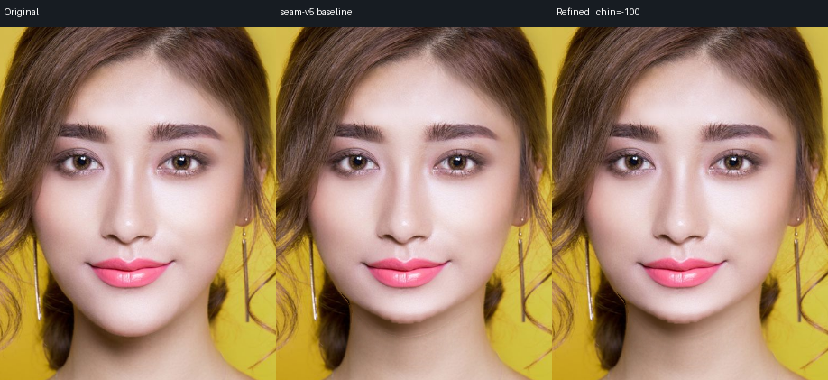
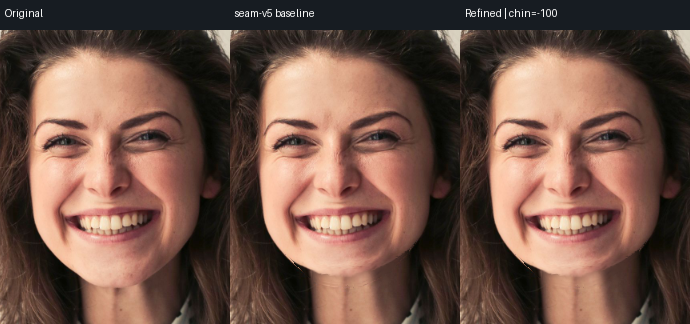
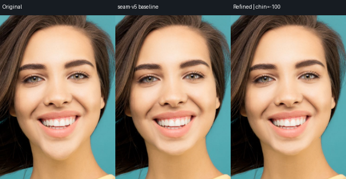

# Face neck demix6 真实回放

日期：2026-10-13。生产候选只修改 `core/image-core/src/face.rs`：将旧 contour 内的 neck/face 混合边去混色 taper 从 1.5–3px 扩到 1.5–6px。目标是语义 contour 与物理 RGB 混合边存在 2–5px 偏差时，移除残留旧肤色浅弧；低频颈部照明重定位、局部 seam bridge、几何 MLS 均不变。

## Provenance

- baseline executable：`.run/face-next-provenance/baseline-image-render`
- candidate executable：`.run/face-next-provenance/neck-demix6-image-render`
- candidate SHA256：`4d3b6423575b2d4ce09b210be3bea8ec845d4e15ae4e3c0159b58b281d499d66`
- 输入：`test/results/face-core-fresh` 中六个 fresh mask graph；`portrait-roll` 是妆容图派生滚转，不算独立人物。
- 回放报告：[replay-report.json](replay-report.json)

## 结果

6 张人像 × `chin/jaw=-100,-60,+60,+100`，共 48 项。所有 ROI、hair、ears、accessories、user protect 和允许 neck-lighting 的场景保护 hard checks 通过（48/48）。没有降低几何强度，也没有让 face/neck 之外背景参与 donor。

`portrait-makeup chin=-100` 的 100% 裁切中，demix6 比 seam-v5 明显减弱旧下颌下方平行浅弧；`portrait-woman chin=-100` 和 `portrait-hair chin=-100` 也未见新的场景或发丝移动。颈部整体光影仍是二维低频 donor，不能据此宣称下巴长度达到 8/10；本次局部评分从约 6.0 提升到约 6.5，仍低于目标。

## 单测

独立 target `.run/face-next-target`：face tests 24 passed、1 ignored（包含新增 `rgb_edge_offset_from_the_class_contour_is_demixed_inside_the_neck_layer` 和既有保护/纹理测试）；`cargo clippy --all-targets -- -D warnings` 已在本候选逻辑上通过。完整 release 构建由主任务执行。

改进边界：此项只去除旧边缘的颜色污染，不会生成被原下颌遮挡的真实皮肤纹理；复杂颈部阴影、遮挡、多人物仍需要后续分层/纹理 inpaint。
