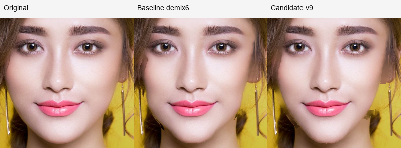
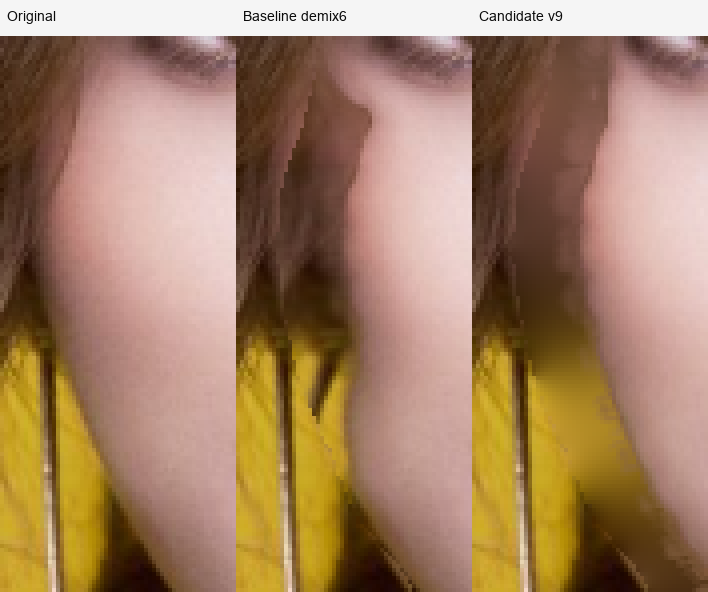
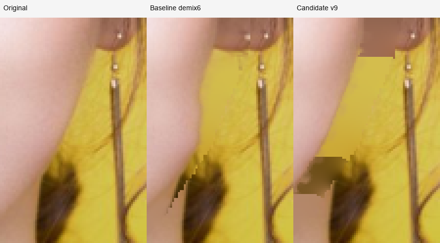
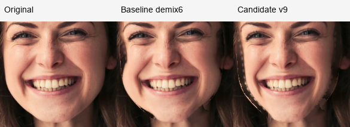
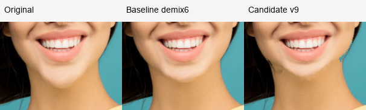
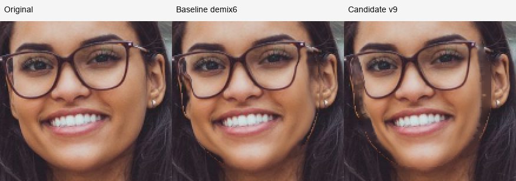
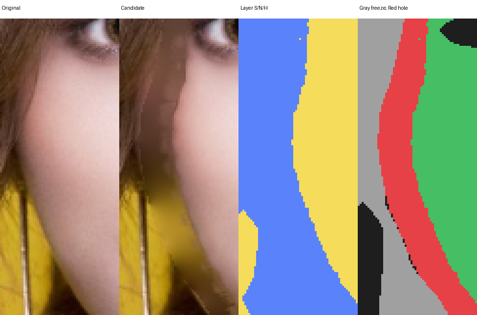
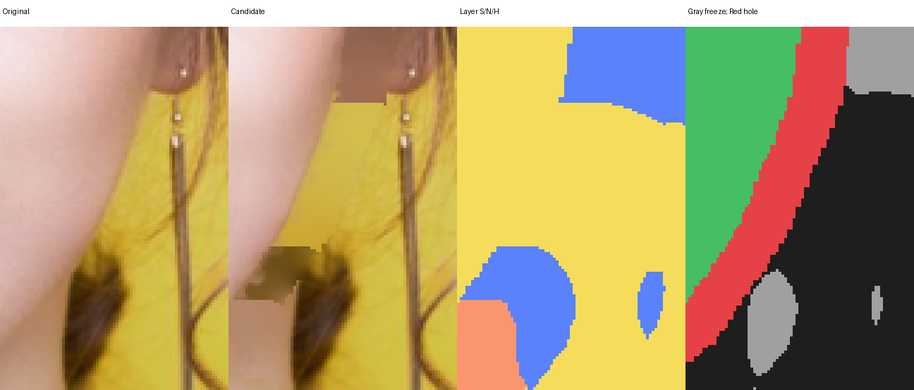

# 人脸面部 alpha、五官 polygon 与合成质量 v9

日期：2026-10-14。结论：几何与保护回归通过，但本轮仍未达到 8/10。按六个场景中的中高强度输出，合成自然度暂评 **6–6.5/10**；不能把正确轮廓位移或 72/72 检查换算成视觉分数。`portrait-roll` 是 `portrait-makeup` 的旋转变体，六个场景不是六位独立人物。

## 改动与保留的合同

- 真正移动的前景改为 `faceContourMask` 面部 alpha，供 F/B 颜色分离、逆采样与旧面部擦除使用。包含头发和耳朵的 head alpha 只提供上下文。
- 已见头发可提供新露出底层的 donor；scene、neck、hair 三类分别传播，头发、耳朵、配饰的原输出像素仍冻结。
- 增加脸部专用 `refine_portrait_alpha`，在腐蚀 2px 的 donor trimap 之间校正已饱和分类、RGB 仍混色的窄边带。身体保持原 alpha 校正入口。
- 五官保护和 MLS 固定点使用真实五官 polygon。旧 enclosing ellipse 的极值固定点会落在可编辑脸颊，留下 identity 岛和局部凹口。
- 下颌旧 neck join 增加同一 neck donor 沿切线的稳健中值处理。没有加入向头发扩大冻结区、减弱参数位移或把 slider=100 改作更小强度的处理。

v9 是对 rigid MLS 与前景颜色估计的项目适配，不能称为新论文算法的完整复现。它仍用局部二维 donor 合成新露区域，无法恢复没有观察到的真实纹理。

## 可复核验证

回放脚本：[review_face_refinement.py](../../../scripts/review_face_refinement.py)。完整输出在 `test/results/face-polygon-v9/`，原尺寸裁切的位置与倍率记录在 [crop-manifest.json](crop-manifest.json)，全部输出与逐项检查见 [replay-report.json](replay-report.json)。

基线是本地 neck-demix6，标记不代表 Git commit：

| 对象 | SHA-256 |
|---|---|
| baseline | `4d3b6423575b2d4ce09b210be3bea8ec845d4e15ae4e3c0159b58b281d499d66` |
| candidate v9 | `58013da0cc9840dd8d4525e9d49ee7a150ba1a02b7f225c26ad525aa21cbbeb1` |

两个 executable 在运行前复制成只读、按 SHA 命名的快照；每次调用前后及最终均核对 SHA。Cargo 构建产物不能覆盖这轮证据。

6 场景 × `faceWidth/jaw/chin` × `-100/-60/60/100` 共 72 次，全部检查通过：

| 检查 | 结果 | 实际含义 |
|---|---|---|
| ROI 外像素 | 0 个变化 | 没有越过用户操作区域 |
| hair/ears/accessories 掩码 ≥.5 的像素 | 全部 0 个变化 | 原输出保护合同成立；不保证解析器没有漏分 |
| 实际眼、眉、鼻、唇、牙齿 polygon 内部 | 全部 0 个变化 | 轮廓工具没有更改这些实际五官内部像素 |
| 显式用户保护像素 | 0 个变化 | 当前回放输入的用户冻结区未被写入 |
| 36 次纯收缩的已见场景背景 | 0 个变化 | 真实背景没有跟随人物一起缩放 |

新增两项有实际旧版失败的回归：饱和分类但 RGB 混色的窄边恢复；眼旁轮廓至少内收 6px，同时实际眼像素恒等。只换输出冻结、仍用旧 ellipse handles 的中间版只有 5px，确实失败；没有降低 6px 门槛，记录见 [failed-eye-handle-check.txt](failed-eye-handle-check.txt)。face_matting 专项 5/5；face 专项在最后一轮 polygon handles 候选中 25 passed、1 ignored；最终撤回临时 hair fringe 覆写后，最终源码由集成测试统一验证，不能把前一候选的完整测试记录冒称最终 SHA 的单独测试。

回放全流程 CLI 中位时间 baseline=515ms、candidate=629ms。它包含 PNG/graph 解码、校验、核心、输出编码，且有其他并行任务；说明这轮没有性能优势，不能等同浏览器 slider 帧率。

## 原尺寸目视与失败样例

本轮主评审检查六张强值原尺寸全图及重点裁切；独立评审另看六张 source 与 36 张输出（`faceWidth/jaw=60/100`、`chin=-60/-100`）。双方都判定未达 8 分。其余外扩方向有像素保护回放，但没有在本报告中授予完整视觉分数。

左、中、右分别为原图、demix6、v9。原尺寸裁切保留一图像像素对应一显示像素；2x/4x 图使用 nearest，不能把插值柔化当成边缘改善。

`portrait-makeup faceWidth=60`：左眼旁旧局部凹口更顺，但左侧棕色平带、右耳下黄棕阶梯仍在常用中等强度出现。它不是只有 slider=100 才失败。

`portrait-makeup faceWidth=100`：左侧新露区域缺少真实发丝，出现平棕色/黄色区域；右耳下层间交界是直角台阶。v9 在该交界没有稳定优于 demix6，部分色块更明显。

`portrait-woman faceWidth=100`：实际下颌收窄，但画面左脸有细亮硬线，右下颌有黑色小块。`jaw=60/100` 也有可见硬边。新五官固定点没有解决这个合成问题。

`portrait-hair chin=-100`：新轮廓位置正确，补偿颈部阴影仍偏平，画面右侧有青色/棕色阶梯。其 `faceWidth/jaw=60/100` 也有耳至下颌的平块。轮廓重塑并不自动获得真实照明。

`fixture-portrait`：强瘦脸两耳下有灰棕色块；`chin=-100` 新露下巴阴影形成偏平的棕灰区域。`portrait-roll` 仍有 makeup 同源耳侧色块，不能把旋转后保护成立作为新增独立人物的成功证据。

`portrait-glasses-street` 是这组中整体最自然的样片，眼镜和耳饰保留；脸缘仍有轻微硬线，强下巴缩短颈部偏平。单张较好样片不能给整个功能 8 分。

## 下一步应解决的原因

需要区分缺陷来自错误 layer 分类、donor 选择、二维隐藏纹理恢复，还是像素 alpha 的偏差。本轮在 `.run/face-v9-diagnostic-src` 加只读 trace，独立编译 target；makeup 强瘦脸、woman 强瘦脸与 hair 强下巴三场景逐像素完全等于 v9，之后才使用 trace 归因。生产源码没有插入诊断代码。

具体 bad point 和 donor 覆盖率见 [donor-diagnostic.json](donor-diagnostic.json)。坐标为原图像素 index；BFS owner 是分类传播 seed，不代表 harmonic 阶段只有这一个颜色贡献者。

| makeup `faceWidth=100` 坐标 | layer/owner | candidate RGB | 原因 |
|---|---|---|---|
| (477,300) | hair / (482,294) | (160,108,77) | 全露出的旧脸像素，sample membership=0；donor hair coverage 仅 .5034 |
| (477,301) | scene / (479,310) | (211,188,78) | 相邻像素切到 scene；绿色通道单像素跳 80 |
| (269,264) | hair / (255,262) | (118,78,65) | 左侧棕色新露条带来自 hair 层，前景样本 membership=.126 |
| (269,337) | hair / (267,337) | (186,144,40) | donor face=0、hair=.653，RGB 已偏黄色；分类不等于干净物理颜色 |
| (440,373) | neck / (440,378) | (179,134,101) | 右下 tan 块来自 neck，而不是 scene |

前两点都不是冻结输出；硬台阶不能归因为耳朵像素保护。`reconstruct` 按 4-neighbor BFS 传播整数 layer，相当于可达 donor 的 Manhattan Voronoi 分区，遍历相等距离时还有固定次序。后续初始化与 harmonic 迭代都只接纳 `layer[n] == layer[i]` 的邻居，故无法跨这条分区纠正不连续。更多迭代不会改变分类断层。

图中第三列 yellow=scene、salmon=neck、blue=hair；第四列 gray=输出冻结、red=hole、green=其他 changed、black=未改。可见右耳下输出的棕/黄阶梯与第三列硬 layer join 同位置；下方 tan 块与 neck 区对应。左侧单一 hair 层虽没有跨层台阶，仍因 harmonic 颜色外推缺少发丝纹理而变平。

这些证据分别支持两个问题：donor 可能处在物理混合边或解析错误处；底层边界延续采用最近整数标签而不是实际 hair/scene、neck/scene 边界。修复 alpha 外缘的候选应单独验证，不能假设它同时恢复隐藏层的纹理或解决全部层间几何。

进一步核对上述 owner：(482,294)、(482,291)、(267,337) 在 v9 的 raw faceMembership 与 refined colorAlpha 均为 0，不能预设将二者统一就会排除这些低置信 hair donor。它们的 donorExcluded=true，但 `known_layer=2` 使它们不进入 target/protected 的未知人物条件；donorFrozen=false，故仍能提供观察 RGB。hair≥.5 是输出冻结合同和粗类别判定，并不是 pure-layer donor 置信标准。(482,294) 的 hair=.5034 几乎正好处在类别阈值；它传播的是 RGB=(167,111,86)，是否由皮肤/头发混合或类别错误造成，需要独立物理分层，不应宣称已恢复真实发色。

更可靠 pure-layer donor 的隔离方向是：分别要求高 neck/hair 置信，排除物理脸部残余 alpha、用户/耳饰保护以及跨材质边界窄带，并按像素距离腐蚀 donor 区。`.9/.95` 可作为实验强度，不能因为阈值提高就称其正确；必须用多图检查 donor 不足、被误拒的细发丝以及分区形状。没有足够 clean donor 时应记录不可处理的失败，而非退回受污染 RGB 或任意混合 neck/hair/scene。更干净的 donor 能改善平块颜色，但不能独自让旧的整数 Voronoi 分区变成真实材质边界。

真实边界切线外推值得做隔离候选：从旧脸外已见的 hair/scene 与 neck/scene 交界提取局部有序边界，用相邻已见片段拟合切线/低阶曲线，向仅新露区域延续，再按 signed distance 合成窄抗锯齿过渡。必须要求两侧干净 donor 和足够连续的边界支持；被完全遮住或分类冲突的边界无法据此可靠恢复。该方向可减少由 Manhattan Voronoi 带来的直角台阶，仍不能保证新露发丝细节。把整数标签改为全域宽混色只能柔化硬线，也会把头发、脖子与场景混成色泥，不能作为 8 分方案。

改进候选应保持真实目标位移、场景与配饰保护，优先解决真实 neck/hair 外侧边界与新露区域的连续对应。不能通过缩小有效 slider、扩大冻结区或模糊整张脸来通过评分。强瘦脸、强下巴、额头/发际线、侧脸，以及明确未实现的 `faceHeight/midface/doubleChin` 都不能宣称已达 8 分。
