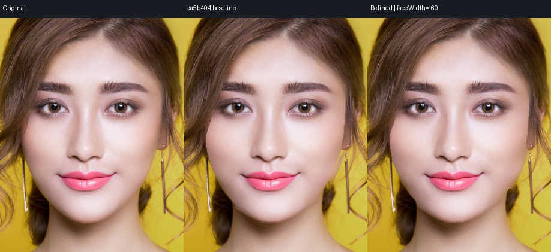
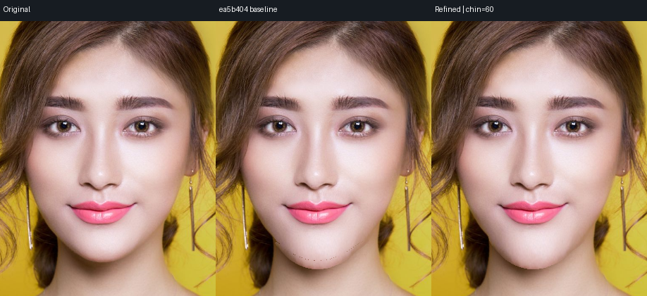
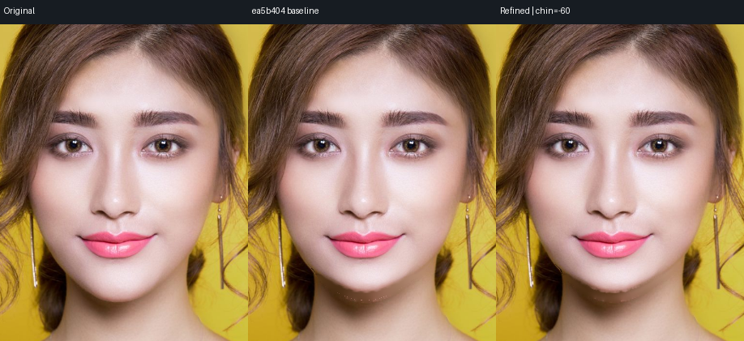
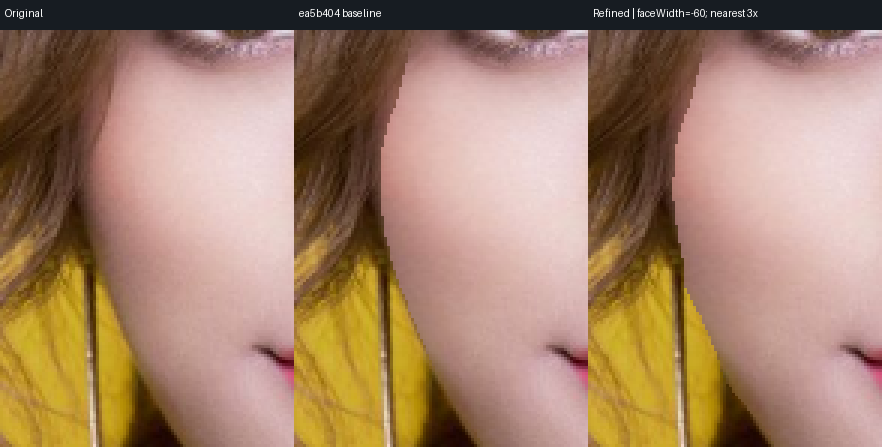
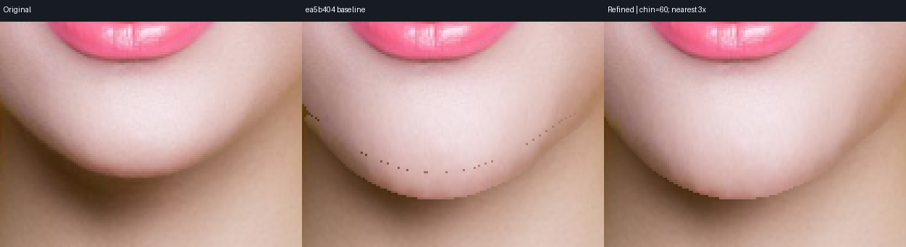
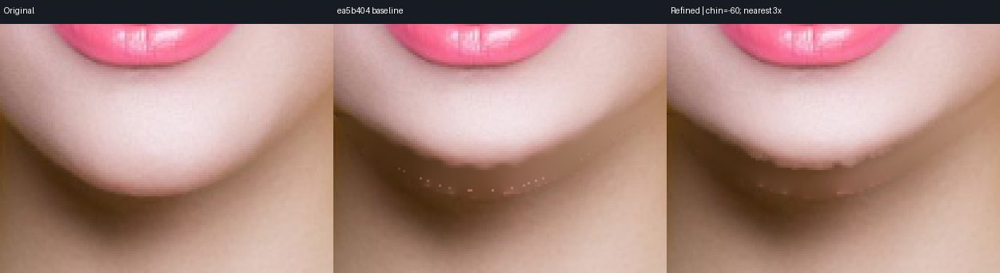

# 人脸边缘 v3：真实改进、作废验证与未达项

日期：2026-10-13。脸型自然度尚未整体达到 8/10。本轮确实修了旧轮廓点线和粗混色边；没有降低参数幅度，没有移动原背景、头发、耳朵或配饰来换取评分。额头、太阳穴和强下巴缩短继续留未通过。

## 算法变更

1. “其他人物”冻结不再把 face/neck 的低置信类别过渡当成另一人。两类 face 支持域均为空且 neck 不存在才构成该冻结证据；扩张前景确实覆盖、距原轮廓 ≤3px 的未知旧边带也允许被新脸前景遮盖。独立用户/头发/耳朵/配饰保护仍优先。
2. 对不透明照片增加有条件的局部颜色线 alpha 校正，再进行原有 F/B 估计和预乘反采样。它保留真实软边，低对比、颜色拟合失败和远 donor 时退回原覆盖率；不是新训练的 matting 网络。粗黄色边带明显减少，不能写成所有亚像素混色都消失。
3. 新露脖子沿源/目标对应轮廓寻找完整 clean neck donor，保留已经见到的阴影与细节。结果按真实暴露宽度退回原重建层，原可见脖子不被几何拉伸。真实隐藏光照和未知纹理仍没有恢复保证。

没有为本轮新功能扩大 hair 覆盖许可。额头真正改发际线需要独立的前景遮挡/发际线策略；当前固定 hair 坐标合同不能证明该功能已完成。

## 一轮验证明确作废

最初一次 108 项九参数回放和 12 项强下巴回放发生了候选 binary 被替换：为了确认新增回归在旧版实际失败，使用了相同 Cargo target directory。`cargo test` 为 integration tests 构建 `CARGO_BIN_EXE_image-render`，覆盖了正常 CLI 候选，而回放只在开头记 SHA；后段实际执行了旧算法，形成混用证据。

该轮 **120 项整体作废**，它们不支持本报告的效果、保护或性能结论。误导的当前对比图已移到本地 `test/results/face-refinement-v3-invalid-mixed-binary`，不继续挂在当前 QA 图中。新增旧版回归实际失败的 [日志](face-refinement-v3/old-regression-failure.txt) 本身有效：独立 `ea5b404` 源码仅附加新测试，旧下颌过渡像素仍为 `[160,100,65,255]`，未覆盖旧暗点。

最终回放使用与 Cargo target 隔离的候选副本；脚本再按 SHA 复制为只读、按内容命名的 executable snapshot。每次 subprocess 前后核对双方 SHA，末尾再次记录。若任一 binary 变化，整个 run 标记 `invalidated` 并失败，不能继续采纳半轮结果。生产 native/WASM 由主任务另外构建验证，候选 hash 不能当作生产 binary hash。

## 当前证据与复现

- [九参数报告](face-refinement-v3/replay-report.json)：六张 fresh 检测照片 × 九参数 × ±60，共 108 项同参数原版/新版对照。滚转照片是妆容原照派生，所以独立原照为五张。
- [强下巴报告](face-refinement-v3-strong-chin/replay-report.json)：六张 × `chin=-100/+100`，另 12 项。原图、参数 seed、输出均留在本地忽略目录。
- 标准最终输出：`test/results/face-refinement-v3-verified`；强下巴：`test/results/face-refinement-v3-verified-strong-chin`。报告保存精确 seed graph 和调整值，不能拿旧图片推断新效果。
- 最终 108+12 项均通过 ROI、hair、ears、accessories 保护；纯收缩的原 head 外像素变化均为 0。两份报告首末 SHA 一致：旧版 `95be1d598f93cd4264bd0b439171016f57b9beb3da6b3ed2ed06611c3ca88fab`，v3 `6a0adbd975b9b4c3df133172e3e118b5340e24bb51777c4143c32fb7d4d9979a`。

```bash
python scripts/review_face_refinement.py \
  --candidate .run/face-refinement-candidate-image-render \
  --output test/results/face-refinement-v3-verified
python scripts/review_face_refinement.py \
  --candidate .run/face-refinement-candidate-image-render \
  --keys chin --values -100 100 \
  --output test/results/face-refinement-v3-verified-strong-chin \
  --doc-output doc/qa/face-refinement-v3-strong-chin
```

每行比较为原图、`ea5b404`、当前修复。缩略图用于找整体缺陷，边缘另外保存 100% 像素的 3 倍 nearest 裁切，放大不引入平滑。







以上最终 verified 输出的原像素边缘裁切（nearest 3×，分别为原图、旧版、v3）：







## 没有抹掉的失败

直接 neck donor 复制曾产生第二条硬弧线，虽然单测和保护指标都通过，目视仍不能接受。这个实际算法失败保留为 [直接复制的失败裁切](face-refinement-v3/failed-direct-neck-donor.png)。当前逐宽度 taper 减少该硬接缝，但强缩短还有新旧颈部阴影不吻合、少量原边缘浅点。不能把“比原版好”写成已达到 8。

长发/短发样片的额头加长仍会在原发际线附近产生平直肤色带，真正的新发际线没有普适实现；太阳穴真实轮廓改变也偏弱。大强度外扩依赖分割精度和固定发丝关系。侧脸检测失败与未实现的 `faceHeight/midface/doubleChin` 未被本轮成功正脸样片抵消。

## 暂评与下一步

以下是对本轮真实样片的主观视觉暂评，既不是独立盲评，也不是四维正式验收。效果、自然度、保护、效率每维达标的正式总分没有被本表取代；本轮沒有任何一项据此标记普适 8 分完成。

| 项目 | 旧视觉暂评 | 当前视觉暂评 | 仍阻止 8 分的原因 |
|---|---:|---:|---|
| 瘦脸/脸宽 | 7.0 | 7.5 | 粗混色线减少；细边缘、发丝交界和强值多骨相还需改善 |
| 太阳穴 | 5.5 | 5.5 | 局部变化弱，冻结头发处真实轮廓移动不足 |
| 颧侧 | 6.5 | 7.0 | 颜色边改善；头发/耳缘交界与强值仍限制 |
| 下颌宽 | 6.5 | 7.0 | 新露底层和颈部照明仍只用二维 donor |
| 下巴宽/尖 | 6.5 | 7.0 | 轮廓过渡改善，但不同骨相及强值未达到普适自然度 |
| 下巴长度 | 5.0 | 6.0 | 延长暗点明显减少；缩短阴影和原边缘浅点仍失败 |
| 额头宽 | 4.5 | 4.5 | 尚无独立发际线/前景遮挡策略 |
| 额头长度 | 3.0 | 3.0 | 当前像素带变化不能当作真正发际线重塑 |

下一步需要真正的 trimap/matting refinement、脸/发/颈部独立层、对原可见颈部光照进行一致补偿，以及与固定发丝区区分的新前景遮挡合同。滑块性能需跨数值复用 F/B 和固定支持 crop，并做实际浏览器延迟测试。仅换一个 MLS 论文名称或增加差分数量不能解决这些问题。

## 单测和性能范围

本轮新增两项 alpha 性质回归、三项脸缘/neck 回归。`cargo test ... face` 是 30 passed、1 ignored，其中有三个其他模块名称匹配项；本脸型与 matting 核心本身为 27 passed、1 ignored。新增旧版回归实际失败，新版通过。独立源码快照的 `clippy --all-targets -- -D warnings` 通过。

CLI 时延包括 PNG/JSON 解码、验证、mask 准备、F/B、MLS、补偿和输出。最终普通回放 v3 范围为 385.04–3548.11 ms，强下巴为 579.64–1543.04 ms。机器同时编译/跑模型时存在明显抖动，报告逐项保留旧/新数值，不据这个环境波动给效率维度 8 分。WASM/浏览器性能与生产集成需单独验证；当前未宣称实时 60fps。
