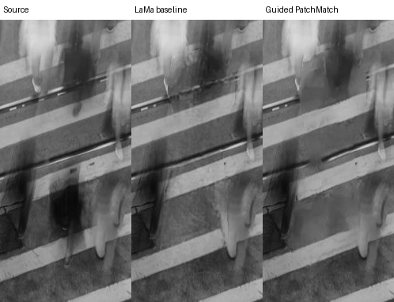
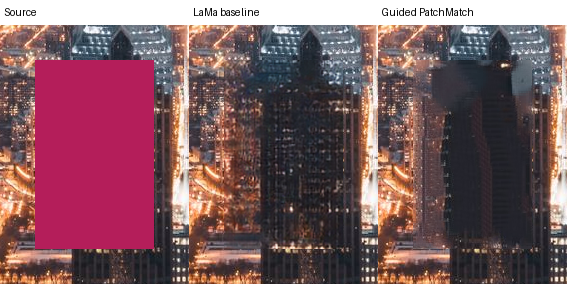
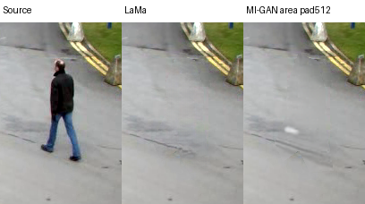
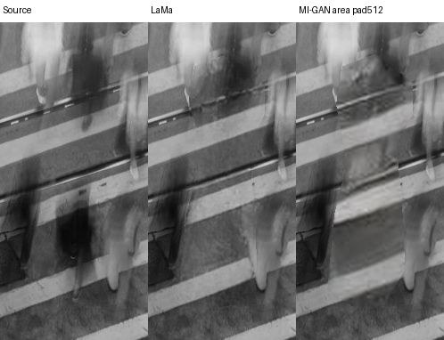
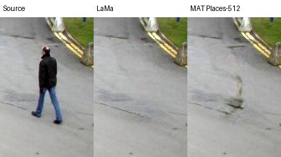
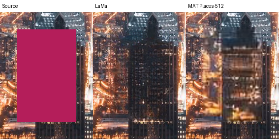

# 去人细化与轻量模型实验：未采用

2026-10-13。本轮真实执行三张既有图的模型后纹理细化，以及 MI-GAN 公开 ONNX。目标是改善复杂线条/纹理并降低客户端模型成本。两条候选均未通过8分自然度要求，正式客户端/服务端仍使用已验收运行合同的 LaMa；失败实验留在 `experiments/inpaint`，没有加入默认流程、Operation、AI/MCP工具或缓存。

所有最终对照在同一原尺寸 PNG target/protection 下合成，原 alpha、目标外及保护区改变均0。建筑是已知 clean 的合成遮挡测试，街景与人群是真实人物；不能把建筑误差当真人去除指标。既有 LaMa 候选来自上一轮真实推理，不在此轮重新生成，也不将模型后处理时间当模型推理时间。

## 引导式 PatchMatch

实现依据 Barnes 等 [PatchMatch，SIGGRAPH2009](https://doi.org/10.1145/1531326.1531330) 的近邻场传播/随机搜索思想，结合 LaMa 候选初始化、已知上下文高权重与不可变原图补丁投票。这是本工程实验实现，未宣称论文完整复现或2026前沿算法。512分析网格，合法供体补丁不得包含目标/保护/非全不透明像素；原尺寸目标内投票，最后恢复硬保护。

三项有意义回归通过：周期纹理补全比均匀模糊候选误差降低；改变删除/保护/透明RGB不能改变修复；无已知补丁显式失败。但是实拍建筑出现更连贯却错误的深色建筑块，人群图出现结构复制和拼接，不能采用。建筑目标 MAE **29.852→29.321/255** 的轻微改善没有反映视觉退化，说明 MAE 不足以验收。

同机并行编译/浏览器任务下，三图总进程5.23–8.88秒（PNG/供体搜索/细化/输出），无受控热性能结论。此前512蒙版下采样的第一轮有439/1679/1055像素 target 差异；最终独立实验CLI直接读全尺寸PNG mask，三项该差异均0，不能混用两轮误差或时间。最终[完整报告](inpaint-refinement/patchmatch-report.json)记录原图/候选/二进制 SHA。

## MI-GAN ICCV2023

原项目：[Picsart-AI-Research/MI-GAN](https://github.com/Picsart-AI-Research/MI-GAN)，论文：[A Simple Baseline for Image Inpainting on Mobile Devices](https://openaccess.thecvf.com/content/ICCV2023/html/Sargsyan_MI-GAN_A_Simple_Baseline_for_Image_Inpainting_on_Mobile_Devices_ICCV_2023_paper.html)。作者维护 HF `andraniksargsyan/migan` 的 `migan.onnx`，revision `406830d0fa60666da0071c342ad2fbc8f30c5c64`，29,546,882字节，SHA256 `593eba0b7e04730f1b61c0a3cbca68d97d8d6a7ff5c6a44a7b9d7fcd880fc5ae`。未核对其所有参数与训练checkpoint，不宣称原权重逐张量验证或浏览器运行已通过。

ONNX接口实际检查：RGB uint8 NCHW、mask uint8 NCHW（255已知、0待修复），输出RGB uint8。原pipeline内部RGB和mask插值足迹不一致；直接输入已置零的原尺寸洞会生成黑色/错纹。实验改为RGB/mask共同正面积缩小、512对称补边，保留比例后调用原pipeline，再还原原尺寸与选区；输入供体不含目标/保护/隐藏RGB。不能仅根据README或模型名字套用另一套数值范围。

街景人物已去除，但路面有白块；人群轨道有错纹/暗块；建筑 MAE35.217高于既有LaMa29.852，窗格仍错误。因此29.5MB体积较小也不足以替换当前模型。Python ORT1.20.1 CPU4线程，加载2.39秒，三图推理7.01/3.01/1.76秒；本机并行负载，不能承诺速度优势，更不能代替真实 ORT-Web 运行。完整[运行报告](inpaint-refinement/migan-report.json)。

`scripts/review_migan.py` 固定来源/哈希/预处理并保留失败；`scripts/check_patch_refinement.py` 对同候选做原尺寸实验。复现入口见 `experiments/inpaint/README.md`。下一轮需要具有更强结构或语义能力的模型实测；本轮复杂去人评分维持原有未达状态，不因新增代码或测试提高。

## MAT Places-512：实测失败，未替换 LaMa

另真实运行了 [MAT CVPR2022](https://github.com/fenglinglwb/MAT) 的 Places-512 safetensors 转换。模型来自 `spacepxl/MAT-inpainting-fp16`，revision `bef6e8b7d535abe2d42fdaeafec903abdfc638a3`，125,280,278字节，SHA256 `309dd6ce6e04034dc4b6b15c7bd2a4844d158e03eb2a139e0eca6b366e40c0de`。架构采用 [Acly/comfyui-inpaint-nodes](https://github.com/Acly/comfyui-inpaint-nodes) 的纯PyTorch移植，固定revision `5b7681746fe19e563113d27366ba85236bc1ba5b`；这是第三方CPU适配和权重转换，不宣称作者CUDA版本完整复现。

`scripts/review_mat.py` 使用float32、Torch2.2.2 CPU4线程、seed0，原比例缩至最长边512，居中补边。输入RGB与已知覆盖共同正面积缩小；删除/保护/半透明RGB不进入已知供体；输出恢复原alpha、保护区和选区外像素，三图这三项变化均0。

实拍街景生成残留人形状的灰绿块；人群仍有轨道断线和重复人形；建筑补全出现不匹配的横层，已知clean目标MAE由LaMa的29.852变为MAT的40.419/255。MAT不能替换当前LaMa。三图推理24.37/17.24/13.03秒（并行开发负载，非受控性能结论）；模型加载见[完整报告](inpaint-refinement/mat-report.json)，不将CPU实验当浏览器通过或速度优势。

新模型名称及公开论文分数不能直接兑换本产品8分效果。复杂去人目标仍未通过，需要新的结构/语义模型与固定样片实测。
