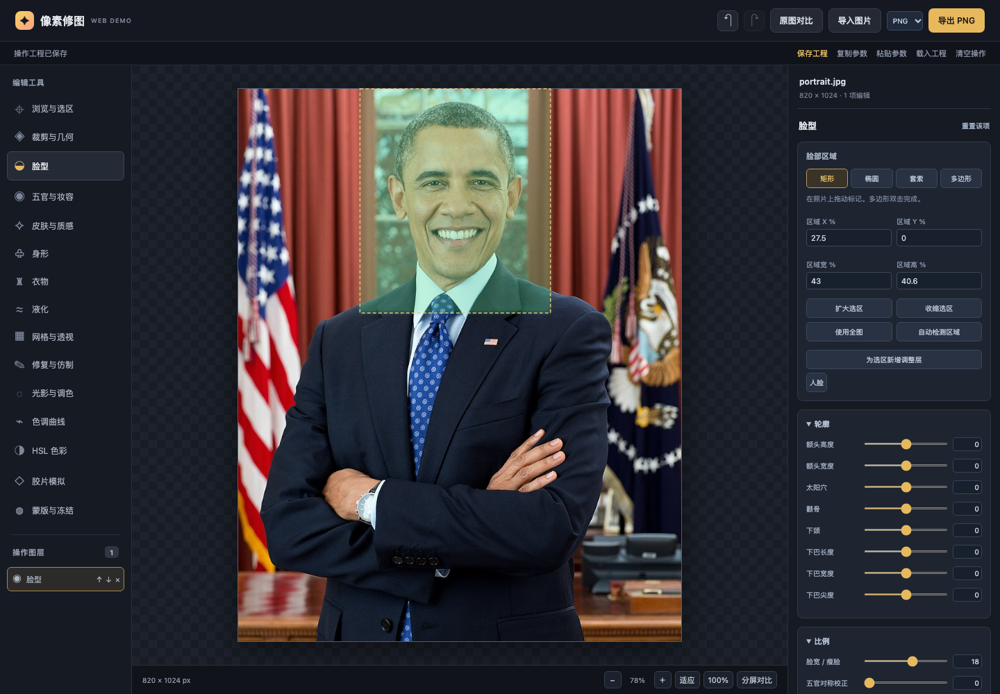

# 第一期 Demo 联调与验收记录

此页是算法整改前的历史联调记录。旧“116项有像素变化”判据已撤销，旧脸型截图不能作为轮廓效果合格证据。当前测试、真实样片结果与未通过项见 [algorithm-validation](algorithm-validation.md)、[人像多图](portrait-multisample-review.md)、[身形多图](body-multisample-review.md)。以下历史数量与结论不代表当前版本验收。

## 验收环境与方法

macOS 本地环境，Web `127.0.0.1:5173`、Go `127.0.0.1:8080`，Playwright Chromium。测试实际导入文件、操作按钮/数值/画布、执行 Rust WASM、读取 Canvas RGBA、下载工程与图片，并调用 HTTP/native；不能只用构建成功判断效果。

固定素材：128×128彩色纹理PNG、96×96逐参数纹理、820×1024真实人像、带EXIF方向6的人像JPEG。真实人像用于本地MediaPipe与native整类操作验证；逐参数像素变化用于确认参数进入算法，不作为自然度评分。

## 自动化检查

| 检查 | 结果 |
|---|---|
| Rust `cargo test` | 72个测试，包含前景轮廓/alpha/冻结/软分割背景修补/肤色/妆容/对称/严格参数校验 |
| Rust `clippy --all-targets -- -D warnings` | 通过 |
| native/WASM release + wasm-bindgen | 通过，两个执行入口共用 `apply_graph` |
| Go `go test ./...` / `go vet ./...` | 上传、全部22类native操作、MCP、提案/revision/jobs与错误路径 |
| Go Race Detector | 此前上传/删除、任务与提案并发测试通过，本轮算法修改未复跑 |
| TypeScript + Vite生产构建 | 通过 |
| Playwright | 19/19通过，完整运行约1.9分钟；这是测试耗时，不是单次修图或实时性能承诺 |
| 可选Agent无密钥 | 此前 TestClient health=200且configured=false；recommend=503，本轮未扩展Agent或调用模型 |
| MCP Python适配器 | 此前实际发现8个工具；真正模型视觉推荐未配置与验收 |

源测试：[浏览器用例](../../apps/web/tests/editor.spec.ts)、[Rust核心](../../core/image-core/src/engine.rs)、[Go集成](../../services/api/internal/api/operations_integration_test.go)、[MCP接口](../../services/api/internal/api/mcp_test.go)。

## 浏览器实际场景

| 编号 | 验证内容 |
|---|---|
| E2E-01 | API不可达仍能导入、真实调色、开关、undo/redo、工程与PNG下载 |
| E2E-02 | 116注册滑杆按各自适用条件执行真实WASM；对称提供完整语义，皮肤/衣物纹理结合磨皮；像素差异不等于自然度 |
| E2E-03 | 手工脸部区、液化、冻结保护、Alt取样仿制 |
| E2E-04 | 同一PNG + RBF face/semantic skin/segmented body/color/film/grain/crop图，WASM/native逐像素 mismatches=0 |
| E2E-05 | 真实人像使用本地MediaPipe Face检测，区域选择和瘦脸参数 |
| E2E-06 | 拖动网格/四角透视、96×80裁剪、48×40尺寸、JPEG签名与质量 |
| E2E-07 | 曲线、HSL、8个真实滤镜缩略图、自定义预设、重排和3D LUT |
| E2E-08 | 绘色与橡皮、heal/inpaint、线性/径向蒙版；工程恢复同像素，非法工程保留已有图 |
| E2E-09 | API生成提案后预览/接受/拒绝/undo；继续手工编辑阻止旧提案覆盖 |
| E2E-10 | Worker实际终止旧预览、25次连续预览只完成最新项，export保持参数快照 |
| E2E-11 | WASM模块加载故障后重建Worker并恢复 |
| E2E-12 | 双向/镜像液化记录方向与坐标，重建中心恢复该层输入；取样选区修补与undo |
| E2E-13 | 双击滑杆复位；蒙版擦除、反选和SVG覆盖提示 |
| E2E-14 | EXIF6浏览器/上传/native导出均1024×820；不强求JPEG解码逐像素一致 |
| E2E-15 | 320/375/768/1440/1920视口无页面水平溢出，参数、下载和图层入口可访问 |
| E2E-16 | 真实人像 Pose 部位 polygon + 人体分割 alpha、收腰、交叉手臂/手掌自动冻结；保存参数与对比图 |
| E2E-17 | 真实人像肤色/妆容语义保存，眼部与背景采样保持；切换五官不丢语义，手工绘色不泄漏参数 |
| E2E-18 | 多边形圈选去除背景杂物，冻结保护主体，真实画布与预览变化 |
| E2E-19 | 先裁剪再检测，语义坐标与当前层输入一致；再次检测不包含本层自身效果 |

AI提案测试通过API提供确定性操作，验证编辑事务与UI行为，没有模拟成真实模型推荐成功。后端jobs/取消由HTTP与MCP测试覆盖，Web没有独立任务管理页面。

## 本次发现并修复

- 上传完成保留等待期间的手工编辑，历史中的asset引用同步更新。
- 本地工程先规范化并由Rust完整渲染，校验失败或期间产生新编辑不覆盖已有图。
- 专属参数只修改匹配类型；LUT UI标题不作为未知Rust参数传入。
- 提案用字符串revision、独立reject、双端基础图校验，预览不进入工程/导出。
- WASM动态导入使用绝对URL；加载失败不缓存到不可恢复的Worker。
- Canvas读取异常显式reject并清理blob URL，避免导入一直等待。
- EXIF方向由浏览器/native校正，Go仅修正展示尺寸不改源字节。
- 4096累计笔画和256操作限制在UI提交前阻止，镜像笔画不会被截成单边。
- 后端直接返回源图仅限空图；含disabled/identity节点先Rust校验，enabled identity混合结果正常执行。
- 窄屏测试使用工具栏容器定位，避免与同名图层按钮产生歧义。

## 本轮算法修正与视觉复核

- 对称由左右像素平均改为眼/眉/唇角几何位置矫正，保留两侧纹理；缺少可靠语义时不提供入口。
- 显式 skin 不再被较大的 face 蒙版扩回；非皮肤/五官/冻结像素不参与磨皮取样，肤色深阴影和高光受保护。
- 有序唇/眉边界与按眼宽/滚转构造的眼下区域；同层妆容在几何采样前着色。
- Pose 人体 alpha 与 RGB 分离重塑，背景固定，仅修补收缩露出的窄带；透明图片不会重复叠加 alpha。
- 低分辨率分割软边跨越 ROI 时，隐藏背景填补域可向软轮廓扩展以连接干净 donor，输出仍仅改目标范围。
- 真实样片曾出现收腰牵动交叉手臂/手掌，已增加自动冻结，并按冻结中心检查像素不变。
- 修正 Face/Pose 可见度规则混用与检测点附加字段进入严格协议的问题。

已目视检查肤色、脸部与收腰对比；肤色变化温和，收腰保护后手掌保持原样。当前正脸与抱胸样片的轮廓变化较轻，不能替代不同脸型、全身腿部与复杂背景的效果验收。脸部尚未独立前景重塑，下一阶段优先处理其轮廓与露出背景。

## 可复查产物

- [116项参数目录](../func/FUNC-010-parameter-ledger.md)：名称、键名、范围与默认值。
- [逐参数像素差异](parameter-pixel-checks.json)：116项全部changed>0且无error。
- [肤色对比](portrait-skin-comparison.png)、[脸部放大对比](portrait-face-comparison.png)、[身形对比](portrait-body-comparison.png)：浏览器真实WASM生成，左原图、右参数结果。
- [编辑器截图](phase1-editor.png)：真实人像、检测区域和瘦脸参数。
- Playwright HTML报告运行后位于 `apps/web/playwright-report/index.html`（生成目录）。



## 验收边界

已验证功能可操作和像素执行，不代表精修自然度、各姿态/肤色普适效果或专业印刷质量。CPU WASM/native + Canvas2D，没有GPU、Tile、30FPS大图或多浏览器性能证明。检测提供人脸 mesh 与特征 polygon、Pose 关键点部位支持域及模型预测人体分割 alpha；部位 polygon 不等于部位像素解析，人体 alpha 不等于精确 matting。尚无自动皮肤/头发/衣物解析。脸部轮廓尚未独立前景重塑，严重褶皱和生成式去人未实现。

背景去除已验收手工圈选/冻结与传统填补，生成式去人、复杂背景重建和真正LLM推荐未完成；手工仿制/修复/近邻填补以及MCP参数调用已可用。无账号、数据库、云同步、RAW/16-bit/ICC/PWA或完整PSD；工程JSON仅保存操作，恢复需原图。离线验收是本地Web资源已经可获取而API/AI不可用，非离线首次安装。

## 重现命令

```bash
make setup
make stop && make dev
make test
make e2e
make health
make agent  # 可选，无密钥应返回503而手工继续
```

更新API二进制后需stop/dev重启，避免正在运行的旧进程；本地服务最终保持启动便于复查。功能范围、技术与对账分别见 [一期计划](../phase1-development-plan.md)、[技术文档](../technical-selection-development.md)、[func索引](../func/README.md)。
