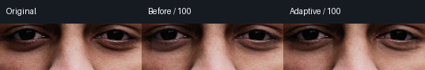
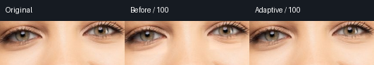
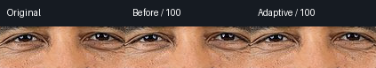

# 黑眼圈自适应光照复核

2026-10-14。`darkCircle` 不再对全部眼下像素加相同亮度。有明确 skin 与眼下语义时，候选从周围未被保护、非透明、眼下区域之外的皮肤采集三环供体，以局部仿射光照平面预测眼下健康肤色，再转移低频亮度差和有限色度差。只改变实际暗沉像素，原高频纹理不直接被平滑。供体过少或布局退化时保持原图；缺少皮肤语义的传统手工区域保留旧行为。

六个缓存样片版本（五张独立原照，portrait-roll 为带妆图旋转派生）× `0/30/60/100`，共24项，参数、来源与固定二进制哈希见 [under-eye-v2.json](under-eye-v2.json)。选区外与 alpha 变化均0，零值逐字节 identity；930–2317 个像素有实际变化，像素数量不换算成质量分数。

目视眼下原尺寸裁切：深肤色暗沉减弱，保留毛孔和下眼睑；自然暖光图比旧版统一灰白带更连续；笑脸的皱纹与高光保持。强档在带妆图仍可能局部偏亮，面部遮挡和眼袋结构没有获得足够验证。当前黑眼圈暂评约 **7.4/10**，未达8，不外推到眼袋/泪沟或医学色素分类。

同轮还把语义蒙版提前编译，纯颜色 feature 图层跳过整图几何反向采样。六图 native 总进程约177–864ms（包括PNG和启动、开发并发）；683×1024 同进程 graph 热中位数217.7ms（不含检测和I/O）。v1 尚未优化的47秒极值是中间工程性能失败，不能拿来当当前结果或受控加速比。

新增回归验证已知光照梯度下暗沉减弱、正常健康皮肤不被加亮、毛孔对比保留、强度递进、保护/透明供体污染不改变结果；PreparedSemantic 与旧光栅器对别名、compact polygon、raster、feather 等逐点对照。完整浏览器/native一致性归入当前验证；这些都是工程合同，不代替照片评分。
