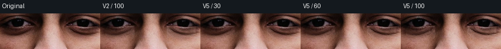
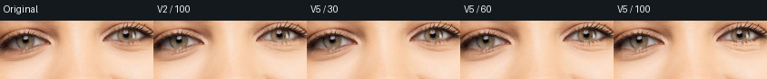
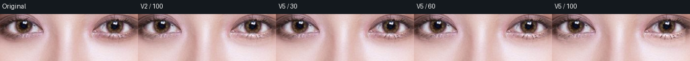
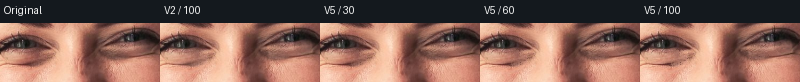
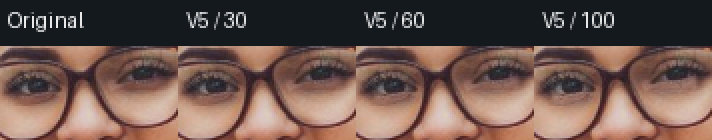

# 黑眼圈稳健供体与暗轮廓保护

2026-10-14。v2 的局部仿射光照模型已能减少固定提亮带，但环形取样可能跨越高光、腮红和解析遗漏的小片颜色，健康肤色参考受少量异常供体牵引。旧眼镜缓存还会让眼下补光触及部分下眼镜框。本次保留 v2 证据，以固定 native 二进制回放 v3/v5，并逐张看原尺寸和放大裁切。

## 当前实现

- 供体先按 skin/选区/保护/alpha 排除，再做三轮加权仿射 RGB 光照拟合。后两轮使用 Tukey biweight 限制异常亮度/色度残差的影响；供体不足或二维布局退化保持原图，避免从一条线外推。
- 从原图低频面估计局部暗沉，仅修正有实际亮度缺口的像素，保持原始高频纹理；有限色度补偿减少蓝/棕色偏。真实阴影修正增益从0.78调整为0.88，亮度修正上限从32调整为38；强度滑杆仍线性控制最终修正。
- 原始像素相对低频面若是窄而深的暗线，连续降低修正。这减少未解析睫毛、眼镜细框、下睑线被涂白的风险。它不是眼镜识别，也不能补偿整片遮挡漏分。
- 不对眼袋或泪沟执行颜色伪实现；两项结构能力仍拒绝非零值，未列为完成。

## 实拍与单测

来源是六个既有人像版本，再补一张独立街拍眼镜人像，共七版本、六张独立原照；portrait-roll 是带妆图旋转派生。每图 `0/30/60/100`，共28项，固定二进制哈希、输入/工程/缓存解析哈希与结果见 [under-eye-v5.json](under-eye-v5.json)。零值 identity，选区外及alpha变化均0；非零参数340–2415个像素改变，最大通道变化40。像素数量和强度不是画质分数。

5个 Rust 专项回归通过：已知光照梯度下暗圈减弱且健康皮肤保持；原高频毛孔对比保留；保护/透明供体颜色不能污染结果；局部亮/色度异常供体不拉偏已知健康平面，线状供体布局拒绝；未解析的窄暗轮廓保留、相邻暗沉仍得到修正。新增两项测试证明新机制，不替代实拍。

原尺寸裁切与2倍 nearest 放大都已复核。图中 `V2 / 100` 为原v2生产结果；`V5 / 30/60/100` 是本轮结果。JSON中的 before 则是单纯增益调整的v3候选，不能把两种比较对象混淆。

| 样片 | 观察 | 自然档视觉暂评 |
| --- | --- | --- |
| fixture-portrait | 弱阴影改善，笑纹与下睑结构仍在；不能证明眼袋改善 | 7.8 |
| portrait-dark | 两侧暗沉改善，原纹理保留；极强档仍可看出局部补光 | 7.8 |
| portrait-hair | 暖光下低频过渡自然，未抹除睫毛/下睑 | 8.0，仅此场景 |
| portrait-makeup | 眼下偏色减轻，强档局部仍偏浅 | 7.6 |
| portrait-roll | 旋转后与同原照一致；非独立统计样本 | 7.6 |
| portrait-woman | 降低部分暗沉但自然下睑线保留，结构眼袋感仍在 | 7.4 |
| portrait-glasses-street | 旧解析无accessories/ears；窄暗线误提亮减少，但半透明细框/遮挡仍漏分 | 6.5 |

普通正脸自然档整体暂评约 **7.7/10**；包含旧眼镜缓存后的泛化能力更低。只有单一暖光场景达到8，不能宣称黑眼圈功能整体8分，更不能外推到结构性眼袋/泪沟。评分是开发者目视复核，没有盲评或商业产品同参数对照。

眼镜裁切中，仅作诊断地统计原图近眼区域亮度<50的像素：v3有66个被提亮，v5降到17个；该阈值包含真实皮肤/睫毛，不是人工标注的眼镜框，因此只能说明暗线误改减少，不能作为眼镜保护验收。

本机 native 总进程约139.54–1140.11ms，包含PNG解码/编码、进程启动与并发开发负载。没有受控热运行或浏览器专项性能数据，不宣称实时。v3/v4为中间候选，最终默认代码是v5；旧实验结果保留但不算新增完成项。

后续要补新版accessories/ears解析的独立眼镜/真实侧脸/暗光样片，加入人工圈出的眼睑线、眼镜框、真实色素暗沉标注；先把定位与结构分类做好，再决定结构眼袋/泪沟模型。单靠继续增加补光强度无法完成这两项。
